[Chataltul docs](README.md) › Using Chataltul

# Cats

Chataltul works a lot like Forest, except instead of planting a tree you invite a kitten. It shows up when you start a block, grows up in the ring while you work, and when the block reaches its end it comes home to your Cat Café. Stop early, or leave Chataltul in the middle, and it wanders off. No drama, it's just not in the café for that one. Every minute of a block whose kitten came home also earns you a 🐟 treat, and treats buy things for the café and cats to adopt. On top of that you can nap together with friends (or anyone, with a room code), do missions, challenges and achievements for extra treats, sponsor shelter cats, and once a year there's a Halloween week and a winter one.

 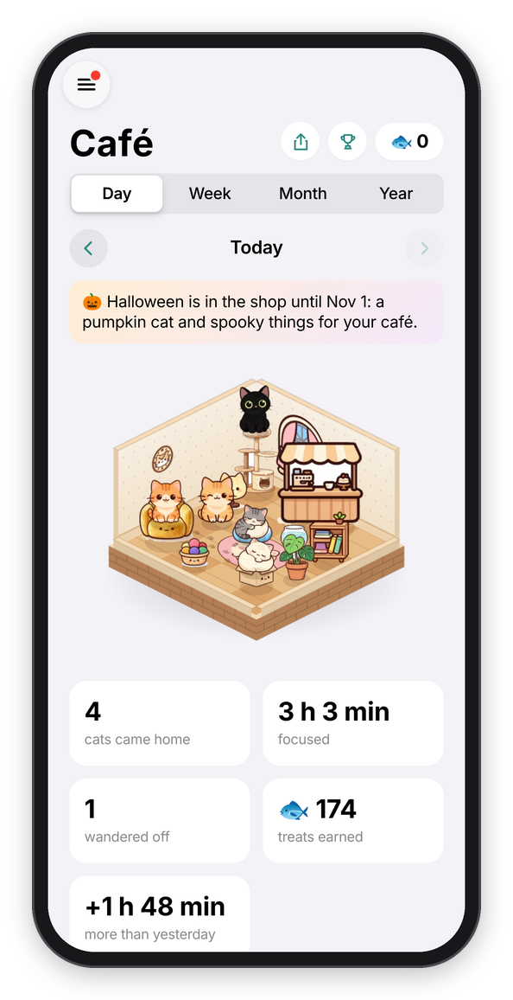

*Miso growing up during a block, and the café at the end of the day.*

## Who's coming

On the Focus tab, the cat sitting in the window is the one you'll invite to the next block. Tap it to pick another one of yours (or **Change** next to **Who's coming** in the sheet the clock opens). Whoever you invite stays picked for next time, and you can also pick from the Cats tab, or from **Settings → Next kitten**.

## While it grows

The kitten arrives napping, curled up on its cushion in the middle of the ring. After the first quarter of the block it wakes up and sits there as a kitten, and in the last quarter it's all grown up. Under 25 minutes it stays a kitten and comes home a kitten, so it's 25 minutes or more for the grown cat (the Focus tab says which, before you start). It hops a little at each stage and gets a tiny bit bigger every second, so you can see it growing. Under the time there's a line about how it's doing ("Miso is growing. Stay with it."), and if you pause, it waits for you.

**Stopwatch** works a bit differently, because there's no end set. The clock counts up (for up to three hours), and you tap **Done** when you're done. The kitten naps for the first 10 minutes, and that's the one rule: stop before 10 minutes and it wanders off, stop after and it comes home, with a treat for every minute. Forest's stopwatch works the same way.

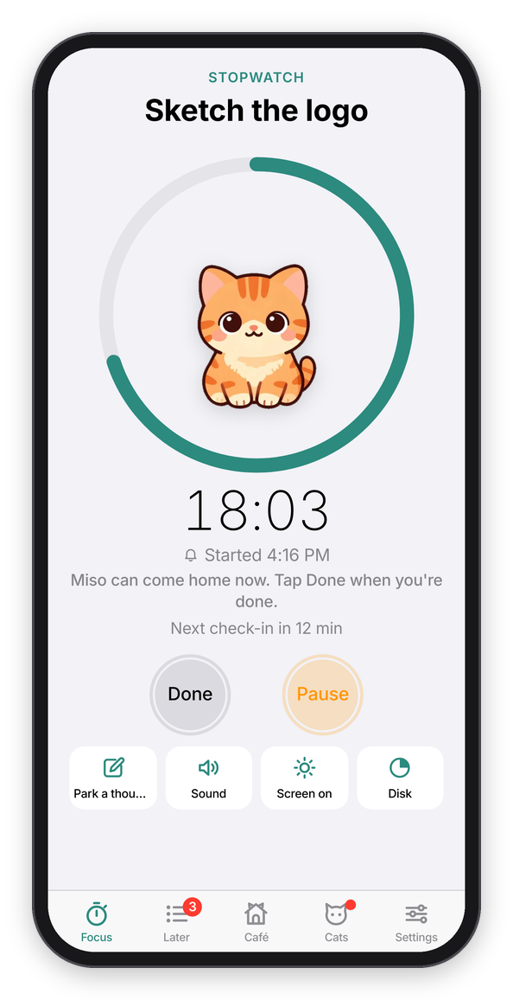

*A stopwatch block, past the 10 minutes.*

If you like, **Sound** has a purring cat too, and the shop has more (see [A focus block](focus-blocks.md#while-it-runs)).

## Staying with your kitten

There are two ways a kitten wanders off:

- **You stop early.** "Stop This Block?" says so ("Miso will wander off."), and you can still say how it went.
- **You leave Chataltul in the middle of a block.** If Chataltul is out of sight for more than about 15 seconds (another app, another tab, a locked screen, or closing it), the kitten wanders off. When you come back you see it go: it tiptoes out of the ring, and its cushion is left with a paw print on it. The block itself keeps going, check-ins and all, so you can still finish the work. There's just no cat for it.

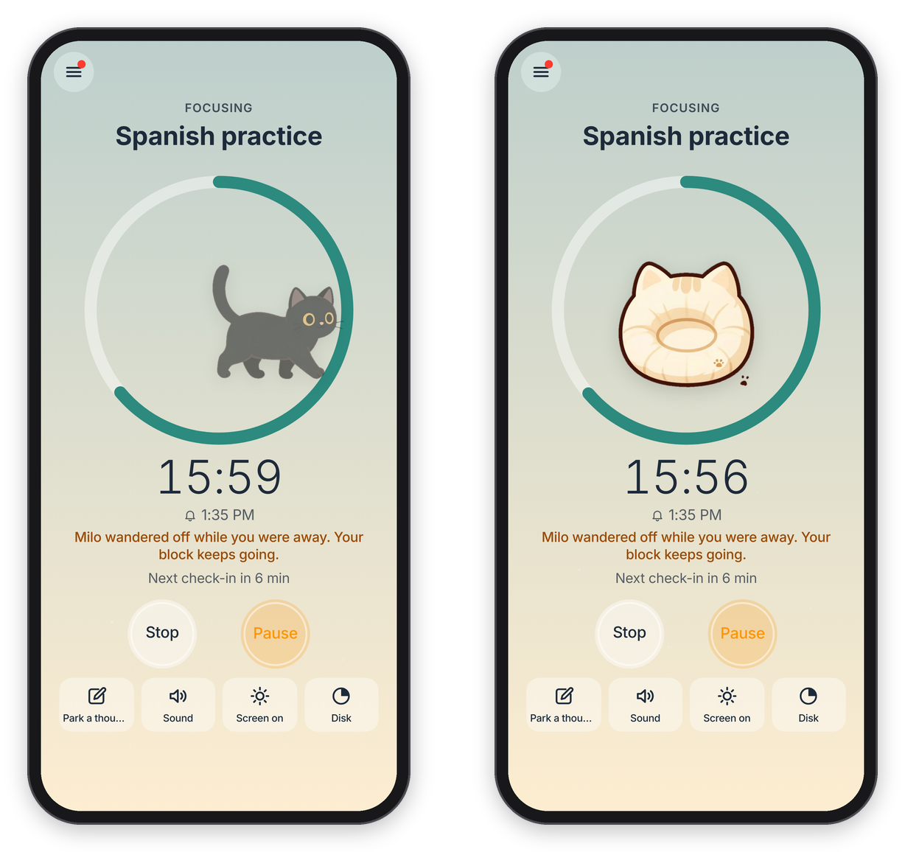

*Coming back too late: the kitten tiptoes off.*

One thing that DOESN'T count: changing your mind right away. For the first 10 seconds of a block, the Stop button says **Cancel (9)** and counts down, and tapping it takes the block back like it never started. Nothing counts, nobody wanders off.

This is the same rule Forest has, and it's the point: the kitten is a reason to stay put. A few things make it fair:

- **A quick look is fine.** Glancing at a notification and coming back within 15 seconds doesn't count.
- **A reload is fine.** Reloading the page never counts as leaving, however long it takes, because losing a kitten to a slow connection would just be unfair.
- **On a computer** the Chataltul window only has to be visible somewhere on the screen, so you can keep it small in a corner and work in the window next to it. [The browser extension](extension.md) keeps the sites you drift to off the screen in the meantime: they show a cat instead until the block's over.
- **The screen stays on** during a block, where the device allows it, because a locked screen counts as leaving too. **Screen on** in the toolbar turns that off if you'd rather.
- **A pause doesn't count,** so pause first if you have to step away. Like Forest's, a pause lasts 5 minutes at most, and then the block goes on by itself (so if you're still away, your 15 seconds start then). If you'd rather have no pausing at all, set **Settings → Pausing** to **Off**.
- **Closing Chataltul counts too,** unless you turn off **Settings → Closing Chataltul counts as leaving**. Then only switching to another app or tab sends the kitten off. Forest has the same switch.
- **With notifications on,** leaving gives you a heads-up: "🐱 Miso is waiting. Come back to Chataltul, or Miso wanders off."
- **Once it's home, it's home.** If you keep going with **+5 min** at the end, the cat is already in the café, and the extra minutes earn treats too. Or turn on **Settings → Count extra time**: when the time is up the kitten comes home right away, and the block keeps counting ("+3:12") until you tap **Done**, with a treat for every extra minute.

## Napping together

If you have friends in Chataltul (see [Focus with friends](friends.md)), you can nap together, which is my version of Forest's "Plant Together". When a friend is focusing, press **Join** next to their name and start. Your kitten and theirs grow up in the same ring, side by side, with their name under theirs, and you both finish at the same moment. With three or more friends, yours sits on top and theirs sit in a row along the bottom of the ring.

The rule is the same as Forest's, and it's the whole point: if ANYONE in the group leaves Chataltul for more than 15 seconds, or stops, every kitten in the group wanders off, yours too. Chataltul says who it was ("Alex left Chataltul, so every kitten wandered off."), and your block keeps going like it always does. If a friend only glances away, their kitten goes pale in your ring for a moment, and nothing happens as long as they're back within the 15 seconds. There's no **Pause** while you nap together, because one person's pause would leave everybody else waiting.

If everybody makes it to the end, every kitten comes home with a bonus: 🐟 5 more for each friend you napped with. So a 25-minute block with two friends brings you 🐟 35 instead of 🐟 25.

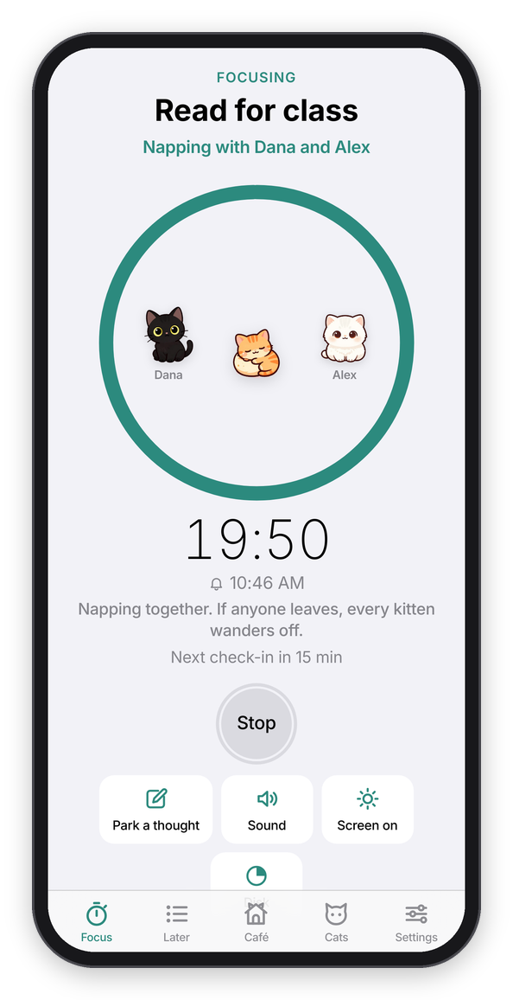 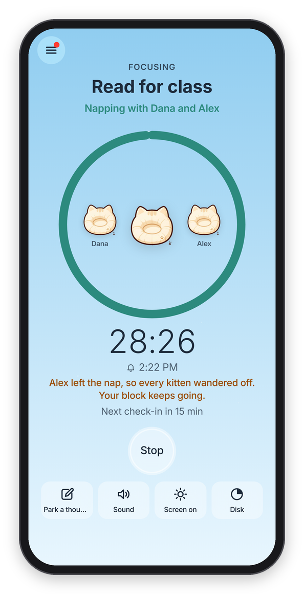

*Napping with Dana and Alex, and what happens when one of you leaves.*

A few details, so nobody's surprised. Anyone who can see you focusing can join your block, because that's what sharing with friends means, so when someone joins, Chataltul tells you right away ("Dana joined you. If anyone leaves, every kitten wanders off."). Up to 8 people fit in one nap. It needs an account and Cat mode, and with Cat mode off, joining is just focusing together, like before.

### Nap rooms

You can also nap with someone who isn't your friend in Chataltul, with a code, like Forest's rooms. During a block, tap **Invite** in the toolbar, and Chataltul shows a 6-letter code with a **Share the Code** button. Whoever gets it taps **Nap in a room with a code** under the Start button (or just opens the link you sent), types what they're working on and starts, and their kitten joins yours. Same rule as always: if anyone leaves, every kitten goes. It needs an account on both sides, but not a friendship.

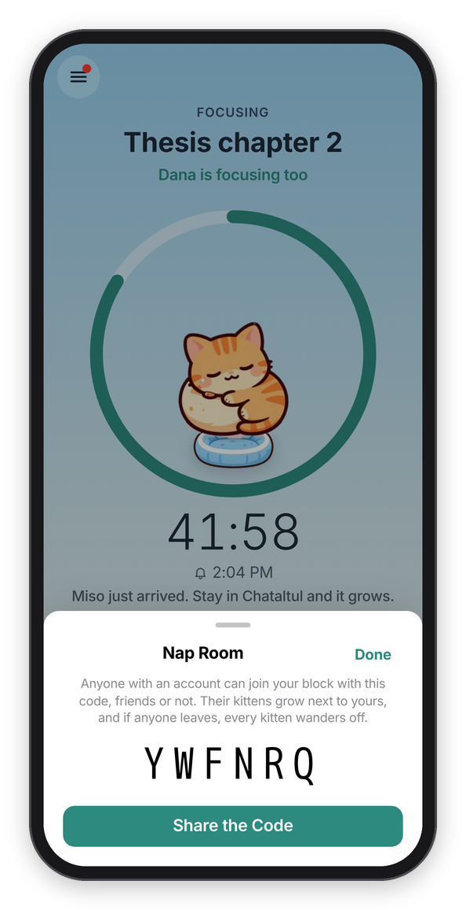

*A nap room's code.*

## The cats

There are sixteen. You meet eight of them by focusing, and you adopt the others in the shop with treats (Pumpkin and Flurry only during their week).

| Cat | What it's like | How you meet it |
| --- | --- | --- |
| **Miso** | An orange tabby who naps while you work. | Here from the start |
| **Milo** | A black cat with gold eyes. Quiet, curious, and always on time. | Finish your first block |
| **Mochi** | A cream cat, soft as a cloud, sleeps in sunbeams. | Focus for 1 hour in all |
| **Pickles** | A calico who shows up when you keep showing up. | Focus 3 days in a row |
| **Noodle** | A tuxedo cat, dressed up for a good break. | Take 3 breaks |
| **Earl Grey** | A grey tabby, a distinguished cat for long sessions. | Focus for 5 hours in all |
| **Biscuit** | A Siamese who says a lot, mostly "well done". | Mark 10 blocks Done |
| **Boo** | A little ghost cat who only comes out late. Boo! | Focus after 10 at night |

| Cat | What it's like | Adopt for |
| --- | --- | --- |
| **Luna** | A white Persian, a fluffy cloud with opinions. | 🐟 200 |
| **Cocoa** | Runs the café, makes a good latte. | 🐟 250 |
| **Olive** | A sphynx who wears her sweater all year round. | 🐟 300 |
| **Dumpling** | A Scottish Fold, round, folded, very sure of himself. | 🐟 350 |
| **Maple** | A Maine Coon, a gentle giant for long sessions. | 🐟 400 |
| **Ziggy** | A Bengal, fast, spotted, always ready to start. | 🐟 450 |
| **Pumpkin** | Lives in a jack-o'-lantern. Halloween week only. | 🐟 300 |
| **Flurry** | Wears her scarf indoors. Winter only. | 🐟 300 |

A few details, so nobody wonders. "Finish" means the block ran to the end, so a block you stopped early doesn't count for Milo. The hours for Mochi and Earl Grey add up every block you've done, stopped ones included. Pickles counts your best run of days ever, so the three days don't have to be this week. Noodle counts a break when you start it, and Boo comes for any block you start after 10 at night (or before 4 in the morning, for the real night owls).

## Meeting a cat

When you've done what a cat needs, Chataltul shows "You met Biscuit!" with a line about it. **Invite Biscuit Next** makes it the cat for your next block, and **Nice!** keeps the one you have. Adopting a cat shows "Welcome home, Luna!" the same way. The Cats tab gets a dot in the tab bar until you look, and the count in the sidebar goes up ("9/14").

Once you've met a cat, it's yours to keep, even if you use **Clear My History** later.

 

*The Cats tab, and meeting Biscuit.*

## Treats and the shop

You get one 🐟 for every minute of a block whose kitten came home, so a 25-minute block is 🐟 25. A block where the kitten wandered off earns nothing. Your treats are at the top of the Café and Cats tabs, and the sidebar shows them next to Café.

**Cats → Shop** is where you spend them:

- **Thirteen things for the café,** from a cardboard box (🐟 20, every cat's favorite) to a café counter (🐟 300). A thing you bought goes into the café right away and stays there.
- **Cats to adopt.** A cat you adopted joins the ones you can invite.
- **Café themes,** which are Forest's land styles: the walls and floor of your café. Classic is free, and there's **Mint** (🐟 100), **Sakura** and **Library** (🐟 150), **Garden** (🐟 200) and **Night Café** (🐟 250). A theme you buy goes on right away, and you can switch in **Settings → Café theme**.
- **Sounds:** a café, a fireplace, waves, birds, a night with crickets, and wind (🐟 60 to 80). Purring, rain, brown noise and white noise are free.
- **Shelter cats,** which have their own section below.

*The shop.*

Treats also come from napping together (above) and from missions, challenges and achievements (below).

If you used Chataltul before the café was there, the blocks you finished back then count as cats that came home (with Miso), and their treats are yours. **Clear My History** empties the café, but you keep your treats, everything you bought, and the cats you've met. With an account, all of it syncs to your other devices.

## Shelter cats

Forest lets you spend coins on planting a REAL tree, and honestly that's one of my favorite things about it. Chataltul's version is shelter cats. At the bottom of the shop, **Sponsor a shelter cat** opens a page with four of them, Ginger Snap, Scrappy, Penny and Domino, for 🐟 1000 each, one after the other. Each one stands for a real cat waiting for a home somewhere, and once you sponsor them they move into your café for good.

The page counts them like Forest counts its trees: how many you sponsored, how many your friends did, and how many everybody did. Treats can't buy cat food, though, so there's also a link to [Best Friends Animal Society](https://bestfriends.org/donate), a shelter that takes care of thousands of cats, if you want to help a real one. No money goes through Chataltul, and the link goes straight to their own page.

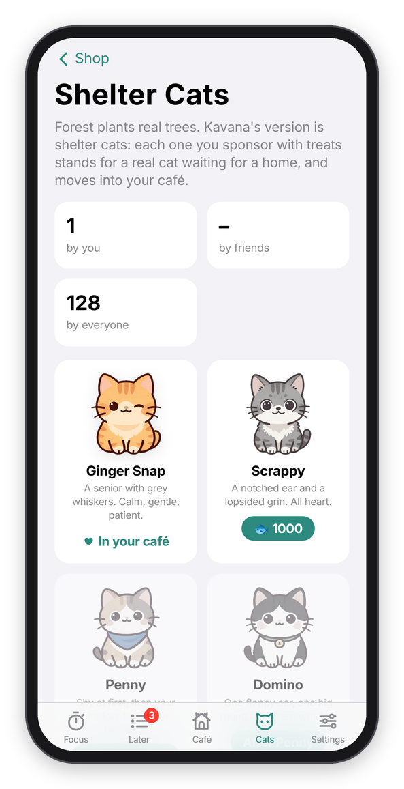

*The shelter cats.*

## Goals: missions, challenges and achievements

All of these are under **Cats → Goals**, and **Goals** in the menu tells you how many of today's missions you've done ("1 of 3").

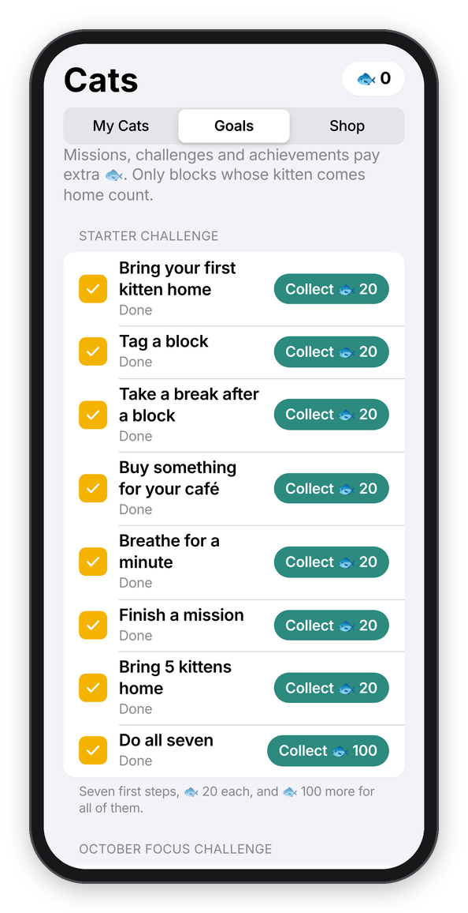 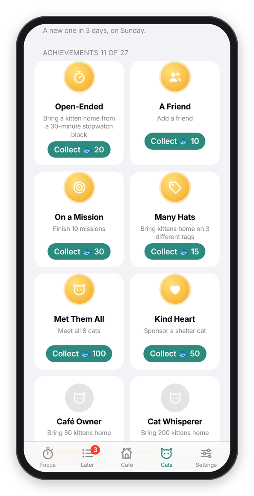

*The Starter Challenge and this month's challenge, and the achievements.*

### Missions

Missions are small goals that pay extra treats.

Every day there are three new ones, and every week (starting Sunday) there's one bigger one. They change every day, but everybody gets the same ones on the same day, so you can race a friend if you want. Only blocks whose kitten came home count, on the day the block started. When you finish one, Chataltul says so ("Mission done: Bring 3 kittens home. 🐟 +15") and the treats are yours right away. One you don't finish just goes away at midnight, or on Sunday for the weekly one. No penalty.

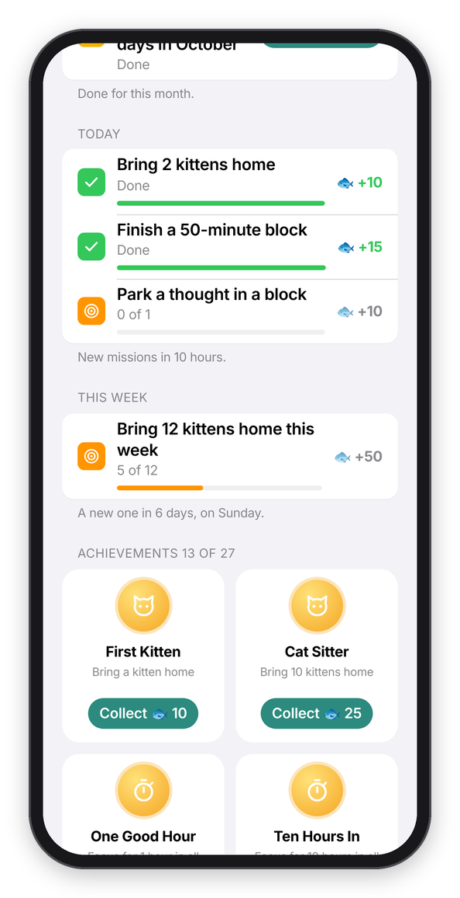

*Today's missions and this week's, two of them done.*

These are all of them. Each day gets one from each of the first three groups:

| Mission | Pays |
| --- | --- |
| Bring 2 kittens home · Bring 3 kittens home · Focus for an hour · Focus for 90 minutes | 🐟 10 · 15 · 15 · 20 |
| Finish a 50-minute block · Start a block before 9 am · Start a block after 6 pm · Mark 2 blocks Done | 🐟 15 · 15 · 10 · 10 |
| Park a thought in a block · Start a block with a first step · Bring a kitten home before noon · Focus on 2 different tags | 🐟 10 each |
| **Weekly:** Focus for 5 hours this week · Bring kittens home on 4 days this week · Bring 12 kittens home this week | 🐟 50 |

One thing to know: **Clear My History** keeps whatever missions already paid, but it closes that day's and that week's missions, so the same mission can't pay twice. New ones come the next day (and the weekly one on Sunday).

### The monthly challenge

Like Forest's focus challenge, every month has one bigger goal: bring kittens home on 20 days of the month ("October Focus Challenge"). It pays 🐟 300. If you finish it on the last day and don't get around to collecting it, it waits for you into the next month.

### The Starter Challenge

When you're new, the Focus tab has a **Starter Challenge** line under the Start button with seven first steps: bring your first kitten home, tag a block, take a break after a block, buy something for your café, breathe for a minute, finish a mission, and bring 5 kittens home. Each one pays 🐟 20, and all seven pay 🐟 100 more. The card goes away once you've collected everything.

### Achievements

There are 27, and they're the long game: focusing for 1 hour, 10 hours, 50 hours and a whole week (168 hours) in all; 1, 10, 50 and 200 kittens home; 3, 7, 30 and 100 days in a row; a 2-hour block; a 30-minute stopwatch block; five early starts and five late ones; napping together; friends; missions; three different tags; meeting all eight cats; adopting three; ten things in your café; and sponsoring a shelter cat. Each one shows how far along you are, and when one is done its medal turns gold and bounces until you tap **Collect** for its treats (🐟 10 to 500).

Rewards you collected stay yours, even after **Clear My History**, and with an account they sync like everything else.

## Halloween

Every year from October 25 to November 1 the shop has a Halloween corner. There's **Pumpkin**, an orange cat who lives in a jack-o'-lantern (🐟 300), and four things for the café: **Candles** (🐟 40), **Jack-o'-Lanterns** (🐟 60), a **Bat Garland** along the top of the wall (🐟 80), and a bubbling **Cauldron** (🐟 120).

They're only in the shop that week, but what you get you keep, so Pumpkin can come to your blocks all year and the garland can stay up as long as you like. The week before, the shop says when it starts ("Halloween starts in 4 days"), and during the week the Café tab has a little banner about it.

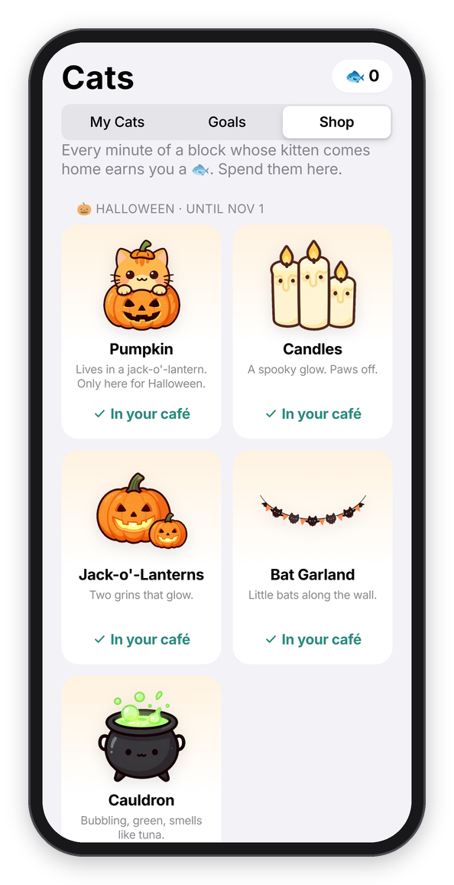 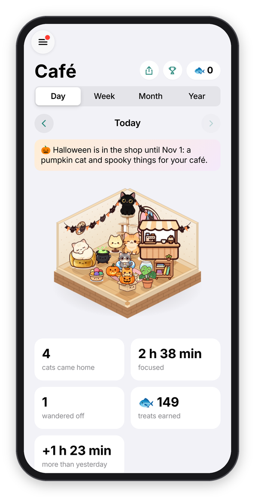

*The Halloween shop, and the café dressed up for it.*

## Winter

From December 15 to January 5, every year, the shop has a winter corner: **Flurry**, a silver cat in a red scarf and earmuffs (🐟 300), and a **Snow Globe** (🐟 40) that sits on the window sill, a **Sled** (🐟 60), a **Snowman** with cat ears (🐟 80) and a **Fireplace** (🐟 150) the cats love to sit in front of. Same deal as Halloween: only in the shop then, yours to keep after. The **What's new** page on the Focus tab says when it's coming.

## Where the cats come from

Everything with paint on it, the grown-up cats, the kittens, the napping ones, the shelter cats and the café's furniture, was painted with an image model running on my own Mac (imagegen-cc), all in one sticker style, and then cut out of its white background. For the 3D café some cats also got walking, loafing, stretching, washing and seen-from-behind paintings (Miso, Pepper, Mochi and Pickles so far, the rest are coming), and some furniture got its sides and back, so it turns when the café does. The cats that peek over a check-in or cheer at the end are drawn in code, so they can blink and breathe. And the paintings don't just sit there either: every one of them has a little rig, where its eyes, head, ears and tail are, and the app bends the picture live, so the cats breathe, blink, flick an ear, swish their tail, look at your finger and hop when you tap them. If you're curious how, it's all in the repo: `tools/paint-cats.js` and `tools/cutout.py` for the paintings, `web/warp.js` and `web/rig.json` for the moving, `web/cafe3d.js` for the 3D café, and `web/cats.js` for the drawn cats and what's painted.

## Turning the cats off

Cat mode is on unless you turn it off, in **Settings → Focus → Cat mode**. Off means no kitten in the ring (the time goes back inside it), nothing wanders off, no "You met..." sheets, and no 🐱 in the notifications (the notifications are in [Check-ins](check-ins.md#the-notifications)). The Cats tab stays, and your finished blocks still go into the café with Miso, if you want to look. And if your device is set to reduce motion, the paw confetti and the hops stay off, and the painted cats only breathe, softly (the ones you can tap still answer you).

Next: [The Café, goal and the daily reminder](history.md) →
