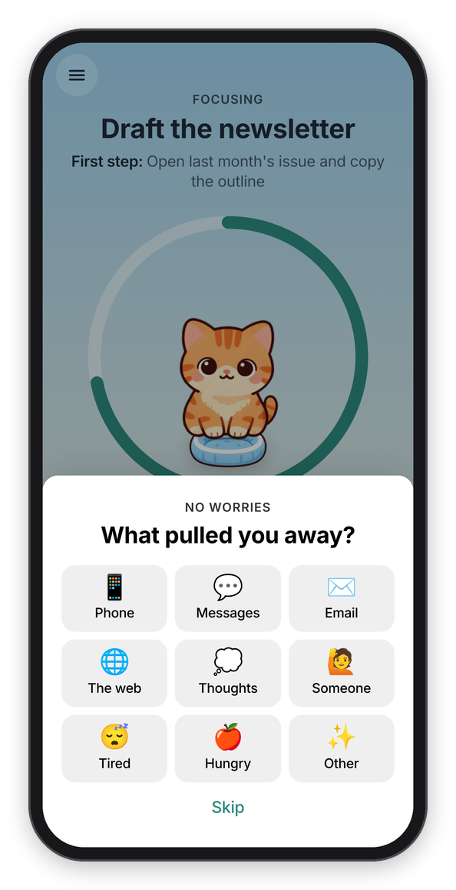
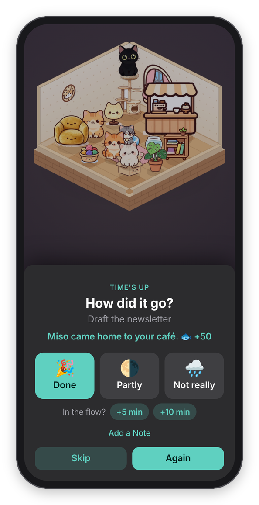
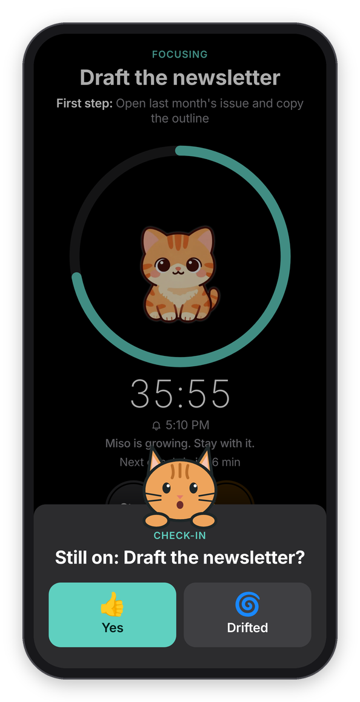

[Chataltul docs](README.md) › Using Chataltul

# Check-ins and Cat mode

A "check-in" is how Chataltul keeps you company during a block, and you pick one of two kinds for each block, in the sheet that the Focus tab's clock opens: **Ask me** or **Nudge me**. This page explains both, what the notifications look like on each device, and what the cat does at a check-in.

## Ask me

"Ask me" asks "Still on: Draft the newsletter?" every 15 minutes (or "Still focusing?" if the block has no title), with two answers:

- **👍 Yes** means you're on it. Chataltul says "Good. Keep going." and goes quiet until the next one.
- **🌀 Drifted** means you weren't, which happens to everybody. It says "No worries" and asks **What pulled you away?**: Phone, Messages, Email, The web, Thoughts, Someone, Tired, Hungry or Other. Tap one, or **Skip**. The line under the ring counts it ("Drifted once"), and the Café tab shows what pulls you away most.

The question comes up as a card from the bottom of the screen, over the running block, and on an iPad or a computer it comes up in the middle. Your cat peeks over the top of it.

 

*A check-in, and what comes after Drifted.*

How often it asks is **Settings → Focus → Check in every**: 10, 15, 20, 30, 45 or 60 minutes, or **Only at the end**. A change there applies to the block that's running too. It never asks in the last minute of a block, because the end is about to ask anyway.

## Nudge me

"Nudge me" doesn't ask anything. It sends a short line now and then, like "One thing at a time.", "Close the tab you just opened." or a quote ("If not now, when?" Hillel), at an uneven gap of roughly the same interval, so it doesn't feel like a metronome. In the app the line shows under the ring, and with Cat mode on, the cat pops up from the bottom of the screen and says it too. The quotes are only ones with a solid source, and the whole list is in `web/lines.js`.

*A nudge, with Cat mode on.*

## The notifications

The check-ins arrive as notifications, so they reach you while Chataltul is closed or you're in another app, as long as reminders are on for that device (see [Install](install.md#turn-on-reminders)). A check-in says "Still on: Draft the newsletter?" with how many minutes are left, and the end of a block says "How did it go?".

- **On Android** the check-in notification has **Yes** and **Drifted** buttons. Your answer is saved on the device, and Chataltul picks it up the next time it opens.
- **On an iPhone or iPad** there are no buttons on web notifications, so a tap opens Chataltul and it asks right there.
- **On a computer** it depends on the browser: some show the buttons, and in any of them a click opens Chataltul.

To send them on time while the app is closed, the server holds your device's next few pings and deletes each one once it's sent. If a ping would arrive more than a few minutes late (say the server was restarting), it's dropped instead of sent late. **Chime when Chataltul is open** in **Settings → Notifications** adds a soft chime for the times the app is on screen.

## The cat

Cat mode is on unless you turn it off (**Settings → Focus → Cat mode**). With it on, your cat is part of every check-in. While the block runs your kitten grows up inside the ring, at a check-in a cat peeks over the top of the card, and when the time is up the one that came home drops into your café, right behind the "How did it go?" card (a kitten that wandered off leaves its empty cushion on top of the card instead). During a "Nudge me" block, and when a break is over ("Boo! Break's over. It's time to focus."), a cat pops up from the bottom of the screen with a speech bubble instead, and it goes away by itself after a few seconds, or when you tap it.

 

*The cat at the end of a block, and a check-in in dark mode.*

The notifications get a cat too: their titles start with 🐱 ("🐱 Boo! Still on: Draft the newsletter?"), and on Android the check-ins, the end of a block, "Break's over" and the daily reminder show a big picture of the cat. Turning Cat mode off in Settings takes the cat out of all of them. How the kitten grows, the café it comes home to, and how you meet and adopt the others is on the [Cats](cats.md) page.

## Do Not Disturb and Focus modes

If you use a Focus mode like Do Not Disturb, the check-ins arrive silently while it's on. To let them through, add Chataltul to the Focus mode's allowed apps (on an iPhone or iPad: Settings app → Focus). Basically, if you're focusing with Chataltul, it's worth letting Chataltul in.

Next: [Cats](cats.md) →
