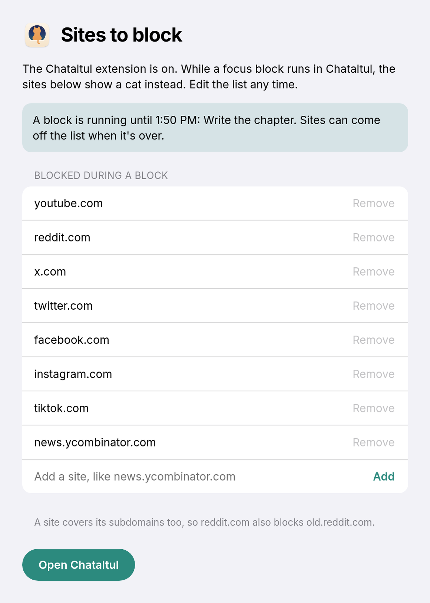
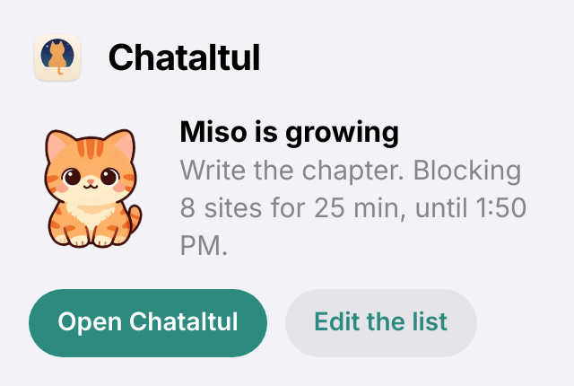

[Chataltul docs](README.md) › Using Chataltul

# The browser extension

Forest has a browser extension that keeps you off the sites you drift to while a tree grows, and this is the cat version of it. While a focus block runs in Chataltul, the sites on your list show a cat instead: "Boo! Miso is growing.", with what you're working on, how long is left, and a button back to Chataltul. When the block's over, the list switches itself off, and any page the cat was standing in for opens by itself, so you can pick up where you left off.

It works on a computer in Chrome, Edge, Brave and the other Chromium browsers, and in Firefox 140 or newer and the browsers built on it, like Zen. It doesn't need an account and it doesn't talk to any server. It hears about your blocks from the Chataltul page itself, which means it works with my copy at stuffs.tiresia.xyz/kavana, and with a Chataltul on localhost while you work on the code.

 

*YouTube during a block, in light and dark mode.*

## Install it

It isn't in the Chrome Web Store or on Firefox Add-ons yet, so for now you load it yourself, which takes a minute. First get the folder: on GitHub, the green **Code** button, then **Download ZIP**, and unzip it (or `git clone` the repo). The extension is the `extension` folder inside.

**In Chrome, Edge or Brave:**

1. Open `chrome://extensions` (`edge://extensions` in Edge, `brave://extensions` in Brave).
2. Turn on **Developer mode** at the top right.
3. Click **Load unpacked** and pick the `extension` folder.

A "Sites to block" tab opens with the starting list, and that's it. It stays installed after a restart. If you want to see the minutes left during a block, pin the Chataltul button to the toolbar from the puzzle-piece menu.

**In Firefox or Zen:**

1. Open `about:debugging#/runtime/this-firefox`.
2. Click **Load Temporary Add-on…** and pick `manifest.json` inside the `extension` folder.

Firefox (and Zen) only keeps a temporary add-on until it quits, so you'll have to load it again after a restart. That changes once it's signed and on Firefox Add-ons.

If Chataltul was already open in a tab, you don't have to reload it, the extension finds it. To update the extension later, get the new folder and click the reload arrow on its card in `chrome://extensions` (or **Reload** in Firefox's about:debugging).

## Using it

Basically, you don't do anything different. Start a block in Chataltul the way you always do, and the list turns on until the block ends. Once the extension is there, Chataltul's **Settings** has a row, **Block sites while you focus**, that says **On**.

The list starts with YouTube, Reddit, X, Twitter, Facebook, Instagram and TikTok. To change it, click **Edit the list** on the cat page or in the toolbar button. Type a site and press **Add**, like "news.ycombinator.com", or paste a whole address and it keeps just the site. A site covers its subdomains too, so reddit.com also blocks old.reddit.com and www.reddit.com. During a block you can ADD sites but you can't take any off, which is kind of the point. **Remove** comes back as soon as the block's over, and **Back to the default list** puts the starting list back.

 

*The list during a block, and the toolbar button.*

The toolbar button shows the minutes left during a block, and clicking it shows the kitten, what you're on and how long is left, with **Open Chataltul** and **Edit the list**. **Back to Chataltul** on the cat page switches to your Chataltul tab if one's open, or opens Chataltul right there.

## How it fits with the kitten

The extension doesn't change the rule about leaving. If Chataltul is out of sight for more than about 15 seconds, the kitten still wanders off, and that includes switching to another tab in the same window. So on a computer, keep Chataltul in its own window (installed as an app, or just a small window in a corner) and work in the window next to it, which is what [Cats](cats.md#staying-with-your-kitten) says too. This way, instead of the kitten being the only thing keeping you honest, the sites you drift to just aren't there.

Opening a blocked site doesn't send the kitten off. You see the cat, you go back to work, and the kitten keeps growing.

## A few details

- **Pauses.** A pause can move the end of a block by up to 5 minutes, so during a pause the list stays on until the latest the block could end. When you resume, it goes back to the real end.
- **Chataltul closed.** The extension sets its own alarm for the end of the block, so the list turns off on time even if Chataltul isn't open anymore.
- **Stopping on another device.** If you stop a block on your phone, the computer hears about it the next time Chataltul is open there. Until then, the list stays on until the time the block would have ended.
- **Only whole pages.** A YouTube video embedded in another site still plays. Only going to the site itself shows the cat.
- **Chataltul itself** never gets blocked, even if its address is on the list.
- **Without Cat mode,** the page just says "Boo! You're in a focus block." If the kitten wandered off, it says "Boo! Your block is still going.", and with **Count extra time** after the kitten came home, "Boo! Miso is home, and you're still going."

## What it can see and keep

It asks for access to all sites, which sounds like a lot, so here's why. Your list can be any site, and a browser only lets an extension put its own page in place of a site it has access to. It never reads the pages you visit. The only page it reads is Chataltul's, and only the little message Chataltul sends when a block starts, pauses, stops or ends: whether a block is running, when it ends, what you're working on, and the kitten. That, your list and Chataltul's address are kept in the browser's storage for the extension, on your computer. Nothing is sent anywhere. The kitten picture on the cat page comes from the Chataltul you use, and removing the extension removes everything it kept.

## For developers

The extension is plain Manifest V3 with no build step, in [`extension/`](../extension/). The same folder loads in Chromium and Firefox: Chromium runs `background.js` as a service worker, and Firefox runs `common.js` and `background.js` as a background page. The Chataltul page sends a `kavana-block` event on `window` (in `tellExtension()` in `web/app.js`) with `{ running, end, intention, cat: { id, name, kitten } }`, and the extension's script on the page (`kavana.js`) keeps it in `storage.local`. Then `background.js` turns one `declarativeNetRequest` redirect rule on or off, for whole pages on the listed domains, with the address you wanted after the `#` of `blocked.html`. The script on the page says `kavana-extension` when it starts, and Chataltul answers with the block again, which is also how Settings knows the extension is there.

To run it with your own server, add your Chataltul's address to `content_scripts.matches` in `manifest.json` (and to `DEFAULT_APP` in `common.js` if you want **Open Chataltul** to go there before Chataltul was ever opened).

Two checks load it in a real browser against a sandbox Chataltul on localhost and take screenshots: `node tools/ext-check.js http://localhost:<port>/ <out dir>` in headless Chromium, and `node tools/ext-check-firefox.js http://localhost:<port>/ <out dir>` in headless Firefox. Both start a Docker container and remove it at the end, and like every test that writes, they refuse my live site. [Developing Chataltul](DEVELOPING.md#testing) has the sandbox.

If something here doesn't match what the extension does, feel free to open an issue.

Back to the [docs index](README.md)
