[Chataltul docs](README.md) › Using Chataltul

# A focus block

A "block" is one stretch of focus on one thing, and it's the whole app: you say what you're working on, pick how long, and Chataltul keeps you company until the end, with a kitten growing up in the ring the whole time. This page follows a block from the Focus tab to "How did it go?", and then the things around it, breaks and the Later list.

## Starting a block

The **Focus** tab is one screen, the way Forest does it: the café wall, a round window with the cat who's coming sitting on its cushion, a big clock and one **Start** button. You don't have to type anything: pick how long and press **Start**. Under the tag at the top there's **Add a title**, if you want one, like Forest's session title: one plain sentence, like "Draft the newsletter", and then the check-ins ask about that. While you type one, your last few titles show up under it, so a thing you come back to every day is one tap away. A tag is optional too. A block without a title goes by its tag in the Café, or just "Focus".

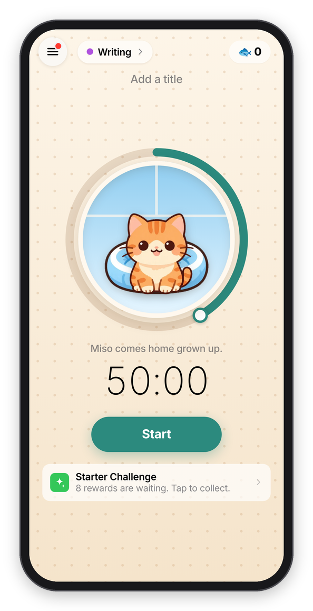 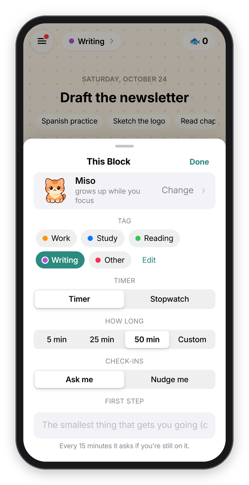

*The Focus tab, ready to go, and everything else about the block.*

- **How long:** drag around the window. The ring goes from 5 minutes to 2 hours in fives, like Forest's old dial (which people still miss), and the clock under it follows. On a keyboard, the arrow keys do the same. The line under the window says what comes home: under 25 minutes your cat comes home a kitten, and 25 and up it's the grown cat.
- **Who's coming** is the cat in the window. Tap it to invite another one of yours. It grows up while you focus and comes home to your café at the end, and the whole story is in [Cats](cats.md).
- **The clock**, or the tag at the top, opens **This Block**, a sheet with everything else:
  - **Tag** says what kind of work it is (**Work**, **Study**, **Reading**, **Writing**, **Other**, or your own), so the Café can show your time by tag. Tap one to pick it, and tap it again for none. See [Tags](history.md#tags).
  - **Timer** or **Stopwatch.** A timer counts down from the length you pick. A stopwatch counts up, for up to three hours, and you tap **Done** when you're done (your kitten needs 10 minutes to come home). Whichever you used last stays picked.
  - **How long** is the same thing as the ring, in buttons: **5 min**, **25 min**, **50 min** or **Custom**, and Custom opens a **Minutes** stepper (1 to 240, and − and + go by five). Five minutes is for the days when starting is the hard part: the hint says "Just start. When it ends you can keep going.", and it only checks in once, at the end.
  - **Check-ins** is **Ask me** or **Nudge me**, explained in [Check-ins and Cat mode](check-ins.md). The one you used last becomes the default.
  - **First step** is for the smallest thing that gets you going ("Open last month's issue and copy the outline"), and it shows under your intention while the block runs.
  - **Nap in a room with a code** is for joining someone's nap room (see [Cats](cats.md#nap-rooms)).

Press **Start**, and you dive into the window: the sky opens out until it fills the screen. Changed your mind? For the first 10 seconds the Stop button says **Cancel (9)** and counts down, and it takes the block back like it never happened.

Under the Start button there's one quiet line at most, whichever matters most right now: joining a friend, a break you've earned, turning on reminders, the **Starter Challenge** while you're new, or what's new. Your friends, if they share, are under that.

### The menu

Everything else is in the menu, the button at the top left. It slides in from the side, with today's minutes and your days in a row on top, and then **Focus**, **Café**, **Cats**, **Goals** (today's missions, see [Cats](cats.md#goals-missions-challenges-and-achievements)), **Shop**, **Later**, **Rankings**, **Friends**, **A mindful minute**, **Shelter cats**, **What's new** and **Settings**. A red dot on the button means there's a new cat or a new post. On a keyboard, **⌘1** to **⌘5** go straight to Focus, Later, Café, Cats and Settings.

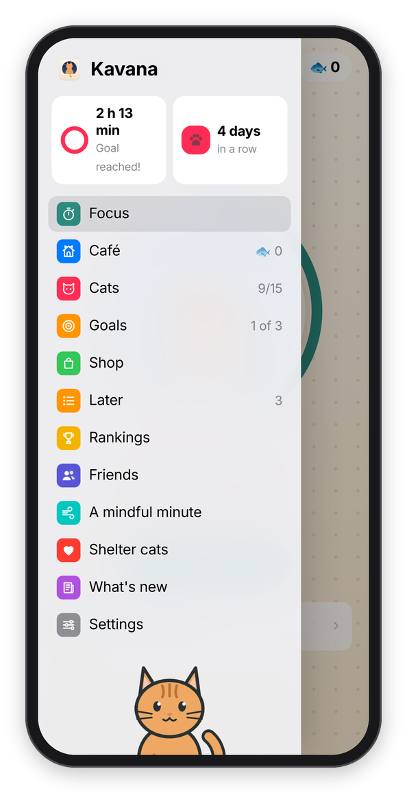

*The menu.*

## While it runs

The block takes over the whole screen, and the screen is the sky in the window you dove into. It starts as a clear afternoon, turns gold and then coral at sunset, goes purple, and by the last few minutes there are stars. In dark mode it's evening already: a calm deep blue with a few stars, going on into the night, so the screen stays dark like the rest of your phone. In the middle is a ring that empties as the time runs out, with your kitten on its cushion growing up inside it. Around that are "Focusing", your intention and first step, the time left with the time it ends, a line about the kitten, and a line like "Next check-in in 16 min · Drifted once". (A stopwatch counts up instead: its ring fills once an hour, and its sky goes from afternoon to stars over its three hours.) Under that are two round buttons and a row of tools:

- **Pause** stops the clock, and the check-ins wait with it. Like in Forest, a pause lasts 5 minutes at most ("Starts again by itself in 4:12"), and then the block goes on by itself. **Resume** picks up sooner. On a keyboard, the space bar does the same. If you'd rather not be able to pause at all, set **Settings → Pausing** to **Off**, and the button goes away.
- **Stop** ends the block now. It asks first, "Stop This Block?" (and tells you the kitten will wander off), and then goes straight to the end. With a stopwatch, or in extra time (below), it says **Done** instead.
- **Park a thought** is for the thing that just popped into your head. Write it down so it stops pulling at you, press **Park**, and you're back to work. The button then says "Parked (1)", the thought shows again at the end of the block, and it lands on your Later list too.
- **Sound** opens a list of 39 sounds in groups: cats purring, rain and water, fire, outside (birds, crickets, wind), places (cafés and a city at night), music, and brown and white noise. One in each group is free, and the others are in the shop. Except for the two noises, they're real recordings that people gave away on Freesound ([Sounds](sounds.md) says whose each one is). Each one downloads the first time you pick it, a megabyte or so, and until it's there, or if you're offline, a version made on the device plays instead. Pick up to two to play together (a fire with a purring cat is my favorite), each with its own volume.
- **Disk** swaps the ring for a disk that shrinks as the time runs out, which is easy to read from across the room. **Ring** swaps back.
- **Screen on** stops the screen from going dark, for a phone or iPad propped up on the desk. It's on unless you turn it off, because a locked screen counts as leaving Chataltul and sends the kitten off. It only shows where the device allows it.
- **Invite** opens a nap room for your block, with a code anyone with an account can join (it needs an account).

Leaving Chataltul for more than about 15 seconds in the middle of a block (another app, another tab, a locked screen) makes the kitten wander off, like the tree in Forest. The block keeps going, so you can still finish the work, and [Cats](cats.md#staying-with-your-kitten) has the details.

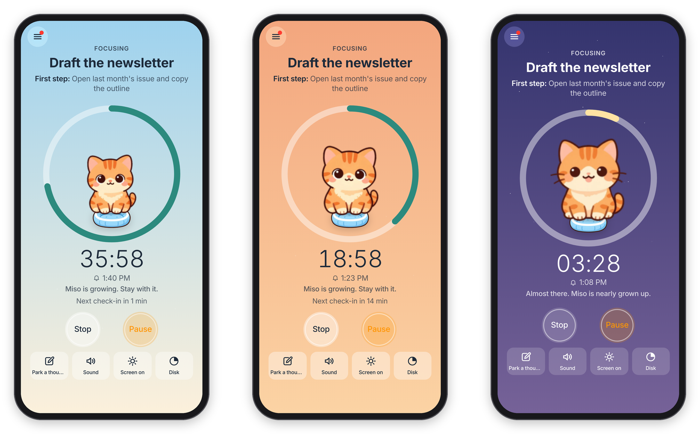

*Afternoon, sunset, and stars at the end.*

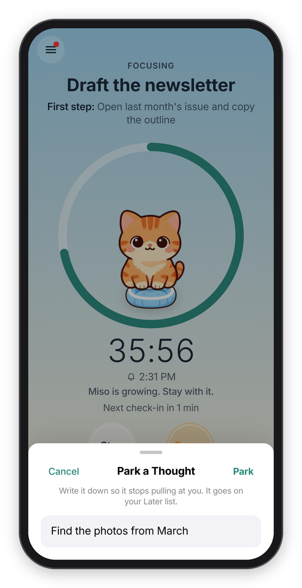 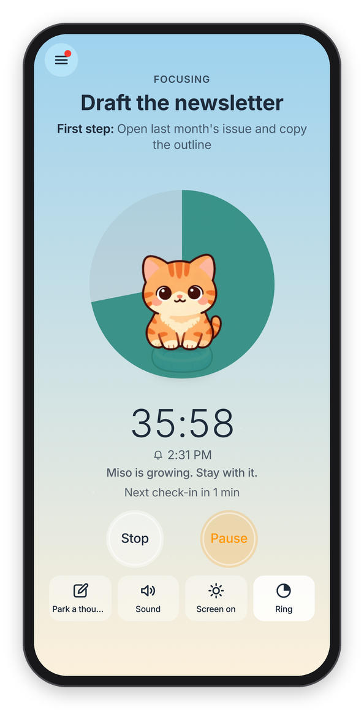

*Parking a thought, and the disk timer.*

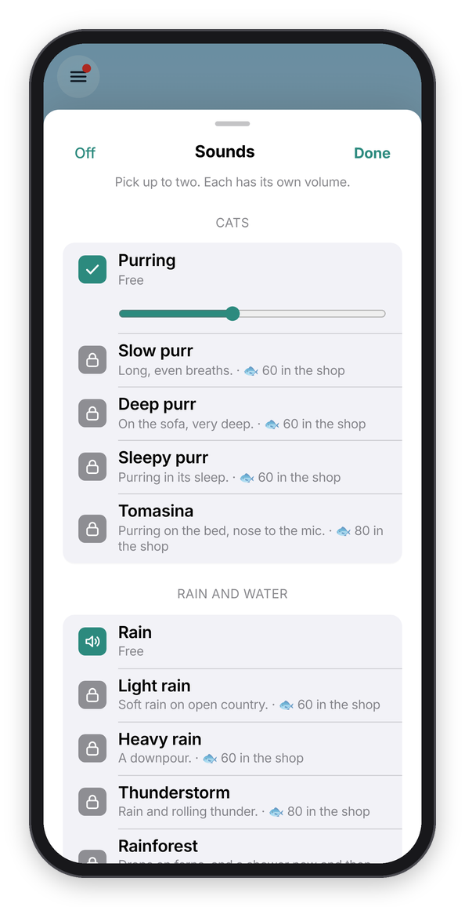 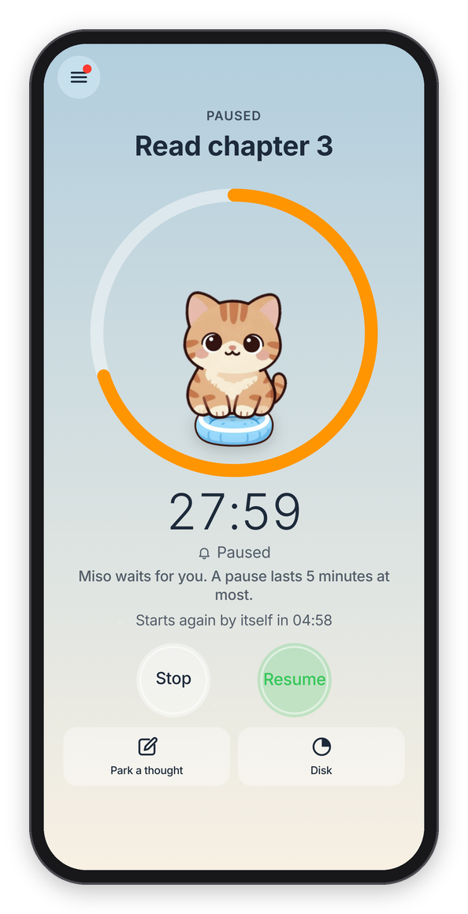 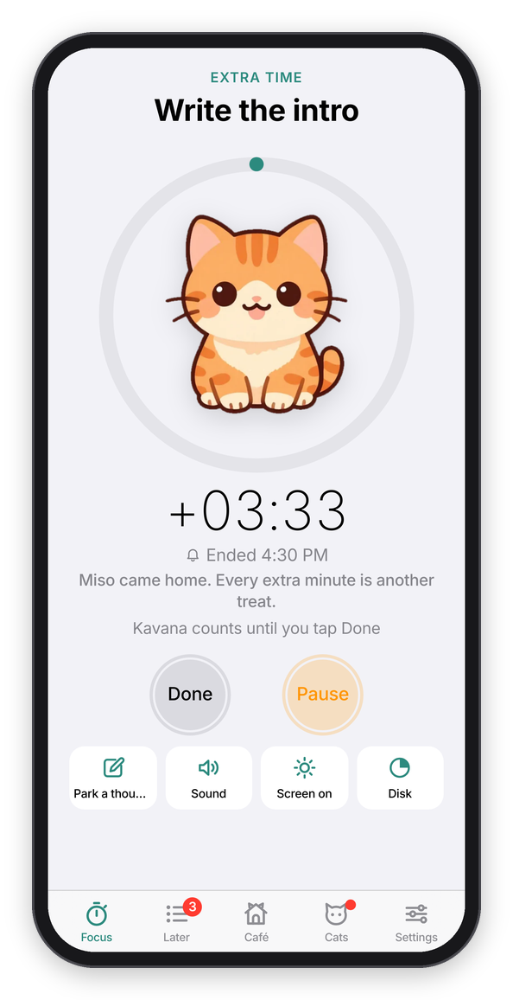

*Two sounds at once, a pause counting down, and extra time.*

### Extra time

Forest has a setting that keeps counting after the timer ends, and so does Chataltul: **Settings → Count extra time**. With it on, when the time is up your kitten comes home right away, and the block doesn't end. The clock counts the extra ("+3:10"), every extra minute is another treat, and you tap **Done** when you're done.

You don't have to stay on the block. The menu is there while it runs too, so you can look at Later, the Café or Settings, and a little pill at the top of the screen, like a Live Activity, shows what you're working on and the time left. Tap it to go back to the block. And when Chataltul asks you something, like "Stop This Block?", it's a small alert in the middle of the screen, the same kind your phone or Mac shows.

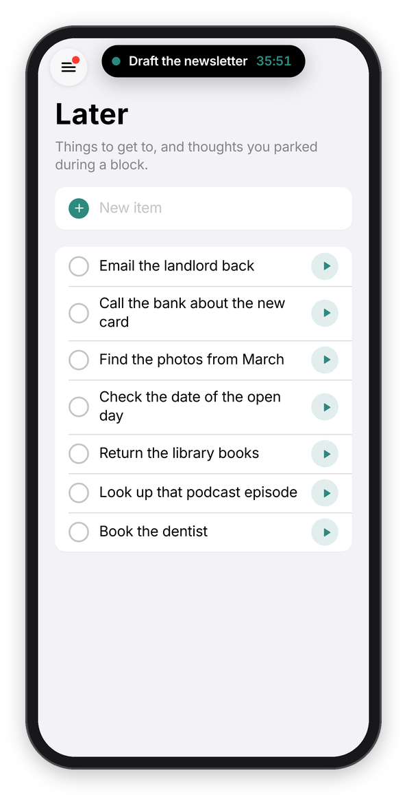 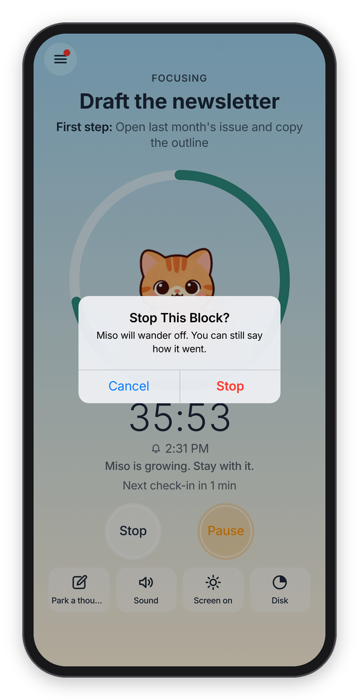

*The pill on another tab, and stopping a block early.*

## The end

When the time is up and your kitten came home, you get to watch it: the sky gives way to your café as it is today, and your cat drops in, lands on its spot with a little bounce, and the treats it earned float up ("🐟 +50"). It takes about two seconds, and a tap brings the card sooner.

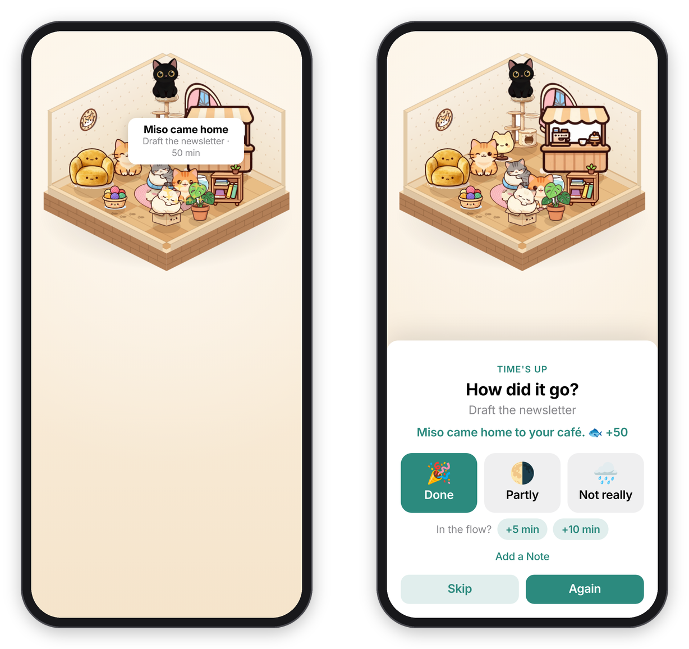

*The homecoming, and the card after it.*

Then a card asks **How did it go?** ("Time's up", or "Stopped early" if you stopped it), with **🎉 Done**, **🌗 Partly** and **🌧️ Not really**, and a line about your kitten on top ("Miso came home to your café. 🐟 +25", or that it wandered off). If you're in the flow, **+5 min** or **+10 min** keeps the same block going (after a short block of ten minutes or less it offers +10 and +20 instead). The thoughts you parked are listed under "You parked", and **Copy Them** copies them as a list, for your notes or your to-do app. **Skip** files the block without an answer, and so does Chataltul itself if nobody answers within 12 hours. **Again** files it the same way and starts the same block straight away (the same thing, the same length, the same tag), with nothing in between, for when you're on a roll.

Tap **Done**, and you get paw-print confetti and "Nice! 50 min of focus." Sometimes that's also when you meet a new cat (see [Cats](cats.md)).

**Add a Note** on the same card is for a line about how it went, or what's next ("Three logo ideas, the round one is best."). Notes show in the Café under the block, and you can change a block later too: tap it in the Café to fix what you worked on, its tag, or its note.

## Breaks and breathing

After a block of ten minutes or more, the Focus tab offers one: "Nice work. Take a break?" with **5 min** and **10 min** (it suggests ten after a long block) and **Not Now**. The break screen says "Stand up, stretch, get some water.", counts down in a mint-green ring, and your cat sits with you. When it's over you get a "Break's over" ping, even with the app closed if reminders are on. **End** ends it early.

**A mindful minute** (in the menu) is box breathing: four seconds in, hold, out, hold, with a flower that opens and closes, like the one on an Apple Watch. Pick **1 min**, **3 min** or **5 min** at the top, and **Sound** plays whatever you picked for your blocks, if you like. At the end it asks "Do you feel calmer?", and **Start Focusing** takes you straight to the Focus tab. **Leave** gets you out whenever you want.

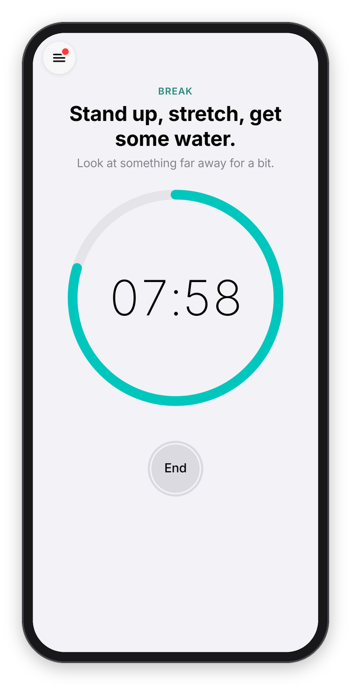 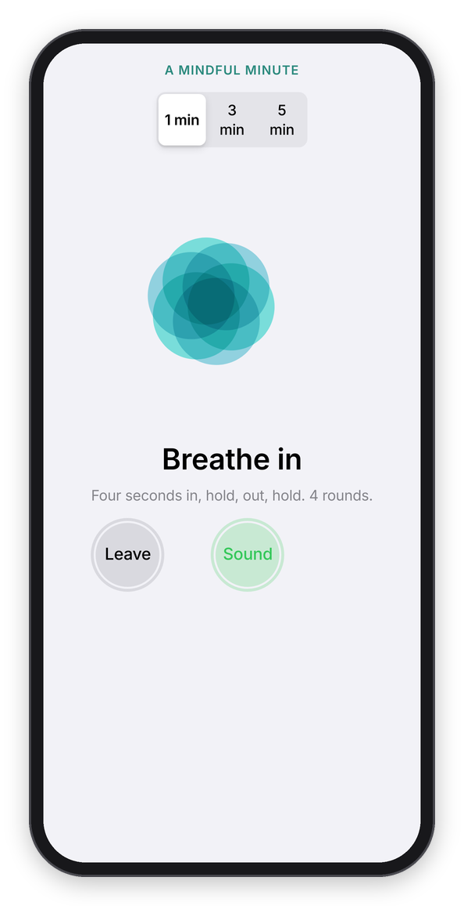 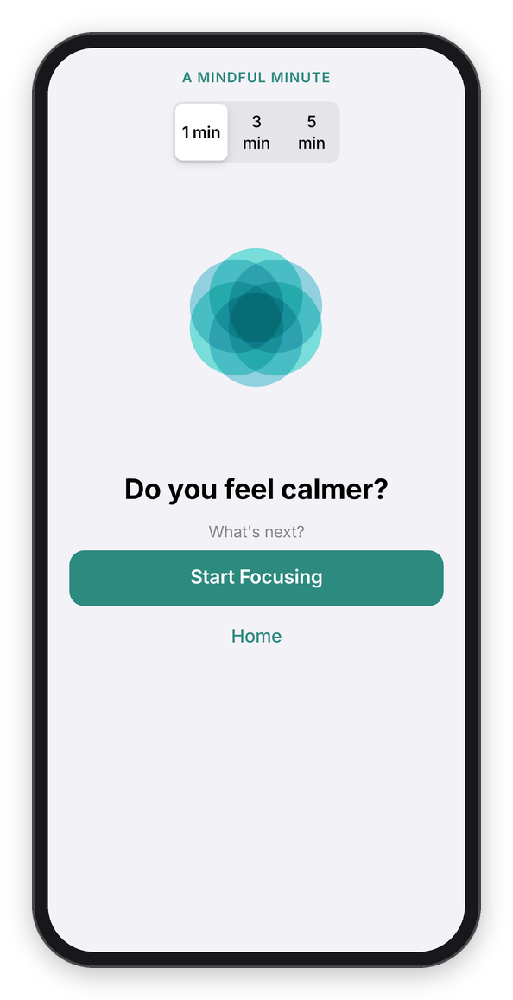

*A break, a mindful minute, and how it ends.*

## Later

**Later** is in the menu, a list like the Reminders app for the things that come up while you're busy, with how many are on it next to its name. Tap **New item** at the top to add something, and every thought you park during a block lands here too. Each one has a circle on the left, which crosses it off, and a ▶ on the right, which puts it on the Focus tab as what you're working on, so you only have to pick how long. It comes off the list once the block starts. If you use the daily reminder, it mentions the top thing on this list ("Up next: ...").

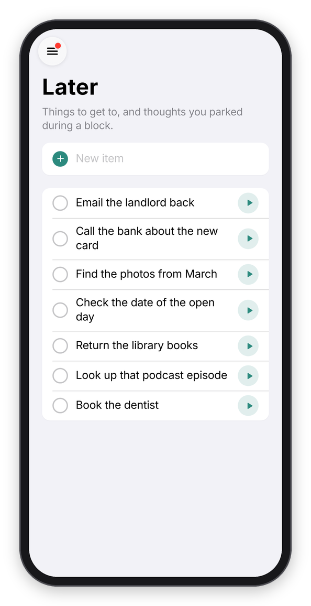

*The Later list.*

Next: [Check-ins and Cat mode](check-ins.md) →
