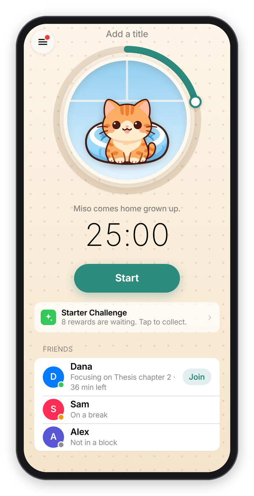
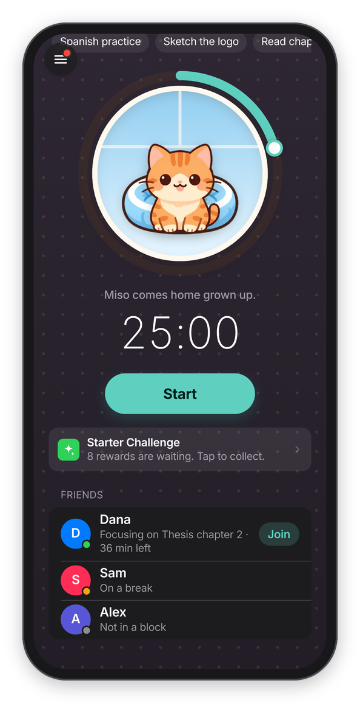
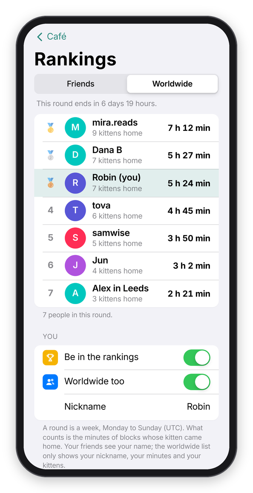

[Kavana docs](README.md) › Using Kavana

# Focus with friends

"Focus with friends" lets you see when a friend is focusing and join their block, so you both work at the same time and finish at the same moment. It's a lot like sitting at the same table in a library, from wherever you each are. It needs an account on both sides, and nothing is shared until you each choose to share.

## Adding a friend

Make an account first (tap **Sign In** at the top of **Settings** and type your email, then the code Kavana sends you, see [Accounts and privacy](privacy.md)). Then open **Settings → Friends**:

1. **Your friend code** is a short code made of letters and digits. Press **Copy** and send it to your friend however you like.
2. Your friend types it into **Add a friend's code** and presses **Add** (or you type theirs). You're now friends with each other, and Kavana says "Friend added. You see each other once you both share."

You can have up to 20 friends, and **Remove** next to a name ends it for both of you.

*Settings → Friends.*

## What you share

**Show my friends** has three choices:

- **Nothing**, which is where everyone starts. Your friends don't see you, and you don't see them either.
- **That I'm focusing**: they see that you're in a block, on a break or paused, and how many minutes are left.
- **What I'm working on**: the same, plus the line you typed for the current block.

It works both ways on purpose: you only see your friends while you share too. **Name they see** is the name on your friends' screens (your account name unless you change it). Whatever you pick, your friends NEVER see your history, your parked thoughts or your check-ins, only the block you're in right now.

## Seeing your friends

Once you share, your friends show on the Focus tab, under the Start button, under **Friends**, each with a round avatar, a colored dot and a line: "Focusing on Thesis chapter 2 · 38 min left", "Focusing · 20 min left" if they only share that they're focusing, "Paused", "On a break", "Not in a block", or "Isn't sharing". If you have friends but share nothing, the Focus tab says "Turn on Focus with Friends in Settings to see when your friends are focusing."

 

*Friends on the Focus tab.*

**Ping me when a friend starts** sends you a notification when one of them starts, like "Dana started focusing" with "Thesis chapter 2. 50 min. Join them?" (the line they typed only shows if they share it). It's at most one ping per friend every 30 minutes, and never while you're focusing yourself, because that would be the opposite of the point. It needs reminders on for the device, like the check-ins.

## Joining a friend

When a friend is focusing with more than a couple of minutes left, their name has a **Join** button. Press it, and under the Start button the Focus tab says "Napping with Dana. You'll finish together at 4:02 PM. If anyone leaves, every kitten wanders off." Add a title if you like (it doesn't have to be the same thing) and press **Start**. The length is set by their block, so there's no "How long" to pick, and **Cancel** goes back to a normal block.

While you work, Dana's kitten grows up in your ring next to yours, and the block says "Napping with Dana" under your intention. That's napping together, and it has one rule: if anyone in the group leaves Kavana or stops, every kitten wanders off. If everybody stays, every kitten comes home with extra treats. The whole thing is in [Cats](cats.md#napping-together). With Cat mode off, joining is just focusing together: "Joining Dana. You'll both finish at 4:02 PM." and then "Focusing with Dana".

In an ordinary block, if friends are focusing at the same time, it says so too ("Dana is focusing too").

 

*Joining a friend, and napping together.*

If you want to try it with someone, the quickest way is to both make an account, set **Show my friends** to **That I'm focusing**, and swap codes.

## Rankings

Forest has rankings, so Kavana does too, and they're opt-in. **Rankings** is in the menu and behind the trophy on the Café tab. A round is one week, Monday to Sunday (UTC, so it's the same week for everybody), and what counts is the minutes of blocks whose kitten came home. The page says how long the round has left ("This round ends in 3 days 4 hours").

- **Friends** ranks you with your friends who are in the rankings too, by the names you already see.
- **Worldwide** is everyone who chose to be in it, under a nickname they picked. It shows the top 50, and where you are if you're further down.

Nobody's in either list until they say so: turn on **Be in the rankings** at the bottom of the page, and **Worldwide too** if you want, with a nickname. The worldwide list only ever shows the nickname, the minutes and the number of kittens, never your account name or what you worked on. Rankings need an account.

*The worldwide rankings.*

You can also nap with someone who isn't your friend yet, with a room code: see [Nap rooms](cats.md#nap-rooms).

Next: [Accounts and privacy](privacy.md) →
