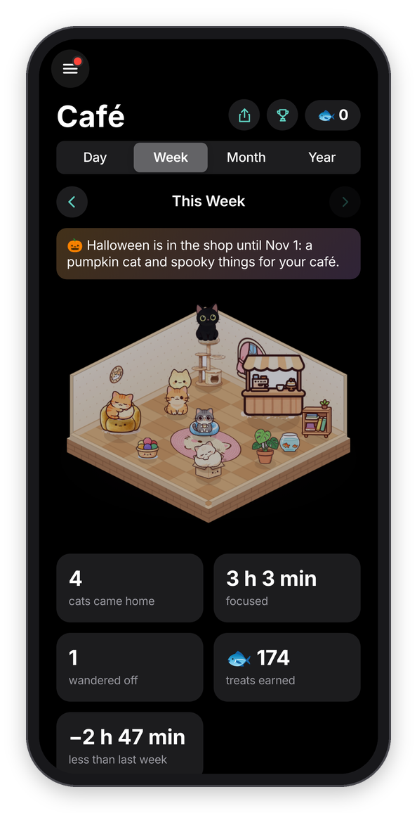
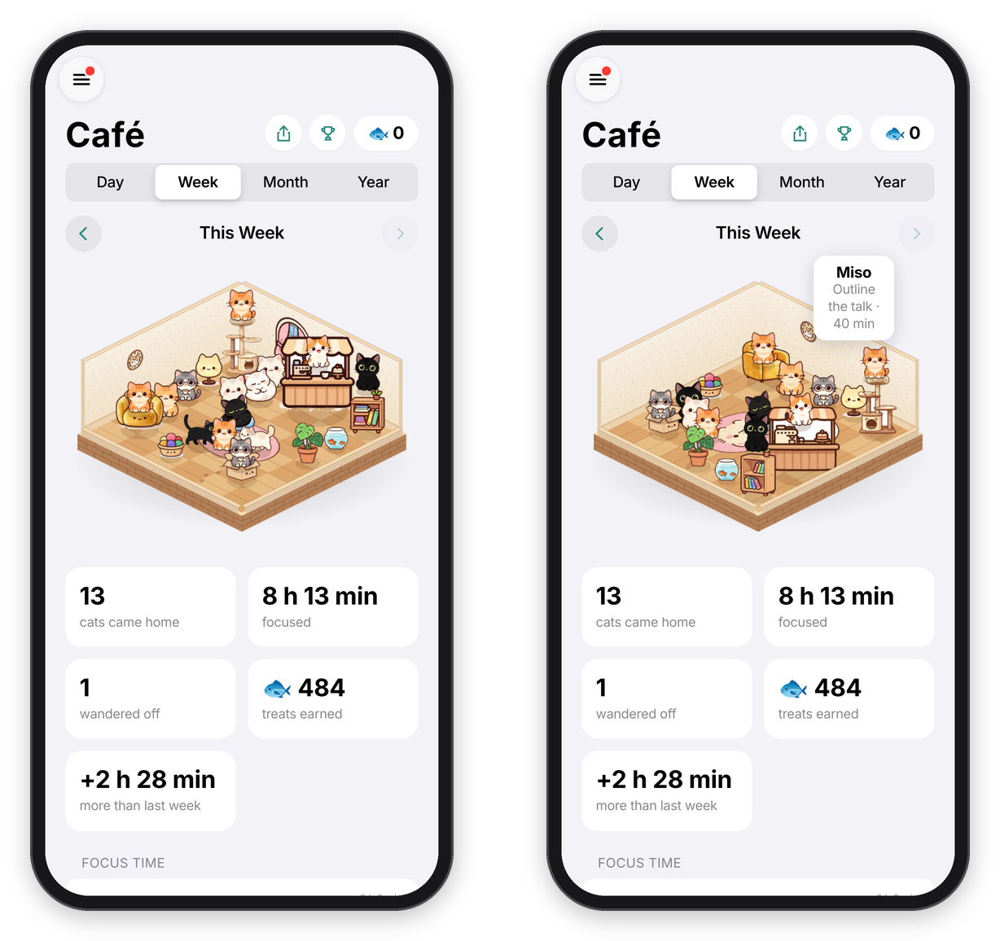
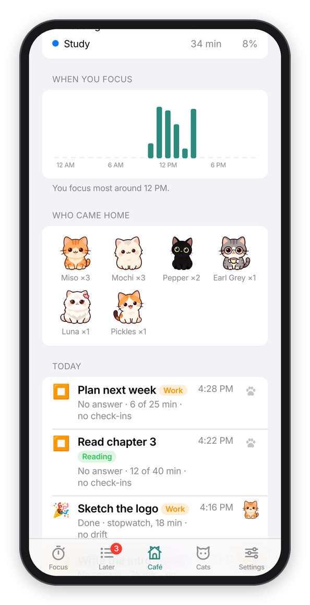
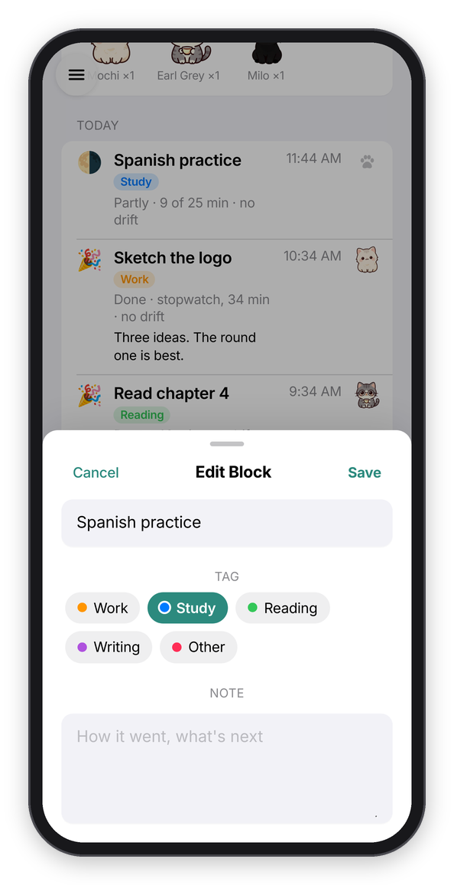
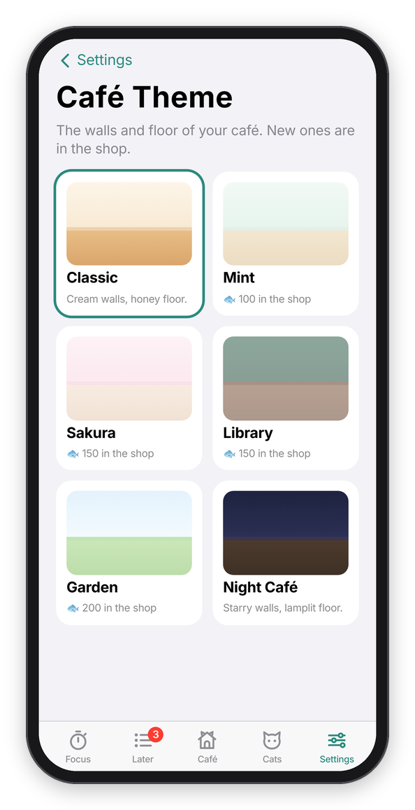

[Chataltul docs](README.md) › Using Chataltul

# The Café, goal and the daily reminder

Every block you finish goes into your history, and this page is about what Chataltul does with it: the Café tab, where the cats that came home hang out next to your focus time, tags, a daily goal, and a daily "Time to focus?" reminder. None of it is a score. It's there so you can see your days, and what pulls you away, without keeping a log yourself.

## The Café tab

**Café** is in the menu (it used to be called History). At the top you pick **Day**, **Week**, **Month** or **Year**, and the arrows go back to earlier ones. Tap the name in the middle ("Today", "This Week", "October 2026") to jump back to now. Next to your treats in the corner are two buttons: the **share** button makes a picture of your café as it is on the screen, with the period and its numbers under it, to send to someone or save (like Forest's share), and the **trophy** opens the [Rankings](friends.md#rankings).

  

*The café today, this month, and this week in dark mode.*

**The room** is your Cat Café, and it's a little 3D room floating on the page, like Forest's patch of forest. Every cat that came home in that day, week, month or year is in it, so a good day looks like a busy café, and a week or a month gets a bigger room. Up to 60 fit, and past that a card says how many more there are. Drag it sideways and it turns, a quarter turn at a time, so you can see it from all four corners, and the cat tree, the counter, the bookshelf and the armchair turn with it. Tap a cat to see which block it was ("Milo · Write the intro · 25 min"), and tap a thing for its name. A block under 25 minutes brought home a kitten, so it's a kitten in the room too.

*Turning the café, and tapping a cat.*

The things you bought in the shop each have their spot (the Halloween bat garland hangs along the top of the walls, see [Cats](cats.md#halloween)), and the first cats take the best seats: the top of the cat tree, the cushion, the box, the armchair, the counter and the bookshelf. Some of the rest walk around, side-on, and then lie down in a loaf, wash a paw, or go and sit at the window with their back to you. A kitten that wandered off leaves a trail of paw prints on the floor. The light follows your clock: a bit blue in the morning, warm in the evening with the lamp glowing, and dim at night.

Under the room are a few cards: how many **cats came home**, how long you **focused**, how many **wandered off**, the **treats** those blocks earned, with the bonus for napping together (missions pay on top of that, and they're on the Cats tab), and how your focus compares with the day, week, month or year before ("+47 min more than last week"). Then:

- **Focus time** is a bar chart: the hours of the day, the days of the week or month, or the months of the year. Each bar is split by tag, in the tag's color.
- **By tag** is a ring with your time per tag around it, and the list next to it ("Study, 2 h 10 min, 45%").
- **When you focus** (for a week, month or year) adds up your minutes by the hour of the day, and says when you focus most ("around 10 AM").
- **Who came home** shows each cat with how many times it came home in that period.
- **Your blocks** in that period (tap one to change what you worked on, its tag, or its note), newest first, grouped by day under "Today", "Yesterday" and then the date. Each one shows how it went as an emoji (🎉 Done, 🌗 Partly, 🌧️ Not really, or ⏹️ for no answer), what you worked on with its tag, the time you started, how long ("15 of 50 min" if you stopped early), how the check-ins went ("no drift", "drifted twice", or the number of nudges), the thoughts you parked, and on the right the cat that came home, or a paw print if it wandered off.
- **Habits** are the numbers over everything, each on its own little card: minutes focused **today** and in the **last 7 days**, **blocks this week**, **days in a row** (a streak still counts until today is over), **check-ins on track** (the share of your "Ask me" answers that were Yes), and what **pulled you away most** this week. Under them, **Last 5 weeks** is a heatmap, one square per day from Sunday to Saturday, with today outlined. A darker square means more focus that day, and if you've set a daily goal, the darkest shade means you reached it.

**Your oldest blocks.** Chataltul keeps your last 2000 blocks, which is a year and more at four a day. Past that, the oldest ones get folded into each day's totals, and the café still counts them: the cats that came home and who they were, the minutes by tag, how many wandered off, and the bars for those days. So last year looks the same as it always did. What those days DON'T keep is the hours and the blocks themselves, which means they aren't in **When you focus** or in the list of blocks (a short note says so), and a period that reaches back there leaves out the **treats** card. The treats are still yours, they're in your balance, just not by day. Tap one of those cats and it tells you the day instead of the block. Basically, the numbers stay right, and only the details of the oldest blocks go.

**Clear My History** at the bottom removes every finished block, and the totals of the oldest ones, so the café empties too. It asks first, it can't be undone, and with an account it clears it on all your devices. You keep your treats (including what missions paid), what you bought, and the cats you've met. It does close today's and this week's missions, so they can't pay twice, and new ones come the next day.

  

*When you focus, editing a block, and the café themes.*

The café's walls and floor are its **theme**, and the Focus tab's wall has the same colors. Classic is free, and the others (Mint, Sakura, Library, Garden and Night Café) are in the shop. **Settings → Café theme** switches between the ones you have.

## Tags

Tags say what kind of work a block was, so the Café can show where your time goes. The one you picked is at the top of the Focus tab, and tapping it (or the clock) opens **This Block**, with a row of them: **Work**, **Study**, **Reading**, **Writing** and **Other** to begin with. Tap one before you start, and tap it again for no tag. The one you used last stays picked, the same as the cat.

**Edit** at the end of the row (or **Settings → Tags**) is where you add your own, up to 12, and remove the ones you don't use. Removing a tag keeps it on the blocks that already have it. Tags are yours only: like everything you type, they never go into the usage counts.

## A daily goal

**Settings → Focus → Daily goal** can be **30 min**, **1 hour**, **1½ hours**, **2 hours** or **3 hours**. The menu has two small cards at the top. The first is today's minutes with a ring around it, like the rings on an Apple Watch, and with a goal set it says "1 h 15 min of 2 h today" and fills up as you go, until it says "Goal reached!". The second is your days in a row, with a paw on it ("6 days in a row", or "Start a streak today").

*The goal and the streak at the top of the menu.*

## The daily reminder

The daily reminder is one ping a day, "Time to focus?", for the days you want a nudge to get started at all. Turn on **Settings → Daily reminder → Remind me to start a block**, set the time, and tap the days you want (all seven are on to begin with). It's sent in your own time zone, and it won't ping you if you're already in a block or on a break.

The text tells you where to begin: if there's something on your Later list, it says "Up next:" and the top thing on it, and otherwise "Pick one thing and start a block." With Cat mode on it comes as "🐱 Boo! Time to focus?". Like the check-ins, it needs reminders turned on for the device (see [Install](install.md#turn-on-reminders)).

Next: [Focus with friends](friends.md) →
