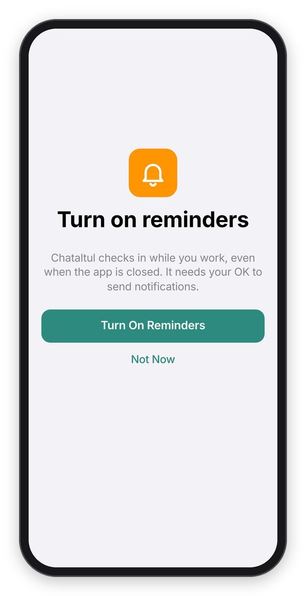
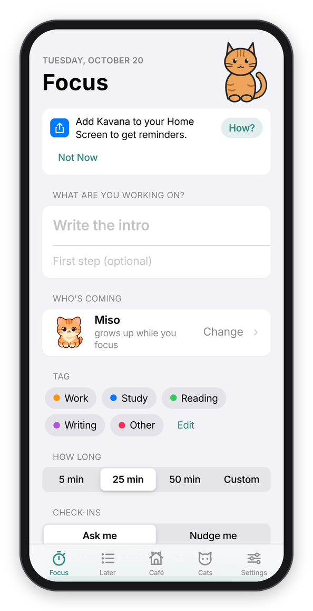

[Kavana docs](README.md) › Getting started

# Install

Installing Kavana means opening a link and, on a phone or iPad, adding it to the Home Screen. There's nothing to download and no app store. My own copy runs at **https://stuffs.tiresia.xyz/kavana/**, and anyone can use it for free, with no account. If you'd rather run your own, see [Your own server](server.md), and everything on this page works the same with your address instead.

The first time you open it, a little cast of cats says hi on a "Welcome to Kavana" screen with the four things to know (one thing at a time, gentle check-ins, cats keep you company, and it stays on your device), and **Continue** takes you to the Focus tab. **I have an account** goes straight to signing in.

 

*The welcome screen, and the reminders screen that follows it.*

## On an iPhone or iPad

Kavana works in a Safari tab, but the reminders only work from the Home Screen app, because that's the only place Apple allows web notifications (iOS and iPadOS 16.4 or newer). In a Safari tab, a banner at the top of the Focus tab says "Add Kavana to your Home Screen to get reminders.", and **How?** opens "Add to Home Screen" with these same steps:

1. Tap the Share button in Safari. On some iPads it's inside the **⋯** menu.
2. Tap **Add to Home Screen**. You may need to scroll down to find it.
3. If you see **Open as Web App**, leave it on. Then tap **Add**.
4. Open **Kavana** from your Home Screen.

 

*In a Safari tab: the banner, and the steps behind How?*

The Home Screen app keeps its own data, separate from Safari. If you tried Kavana in Safari first and want your history in the app, make an account in Safari, then sign in to it in the Home Screen app and everything comes along.

## On Android

Open the link in Chrome, and it works right there in the tab, reminders included. To give it its own icon and window, open Chrome's menu and tap **Add to Home screen** (or **Install app**). On Android the check-in notifications have **Yes** and **Drifted** buttons, so you can answer without opening the app, and with Cat mode on they show a picture of the cat.

There's also a real Android app. Download `Kavana-<version>.apk` from [the latest release](https://github.com/franz-rosenzweig/kavana-apps/releases/latest), open it, and let your phone install apps from that source once. Then allow **Display over other apps** if you want the cat to pop up when you drift off into another app. It needs Android 12 or newer, everything stays on the phone (it doesn't sync with the web app), and [Obtainium](https://github.com/ImranR98/Obtainium) can keep it up to date from the releases.

## On a computer

Any recent browser works: Chrome, Edge, Firefox or Safari. To have it in its own window, use the install icon at the right of the address bar in Chrome or Edge, or **File → Add to Dock** in Safari on a Mac. Reminders work in browsers that support web notifications, and the browser asks you once to allow them. To keep the sites you drift to away during a block, there's also [a browser extension](extension.md) for Chrome, Edge, Brave and Firefox.

## Turn on reminders

The reminders are what make the check-ins reach you while Kavana is closed. Right after **Continue**, on a device that can get them, Kavana offers to **Turn On Reminders**, and your device asks you to allow notifications. Tap Allow. If you said **Not Now**, you can do it later with **Turn On** in **Settings → Notifications**, and a banner on the Focus tab reminds you: "Reminders are off on this device."

Once they're on, Settings says "Reminders are on", and **Test** sends one right away, which should show up in a few seconds. If notifications are blocked:

- **On an iPhone or iPad**, open the Settings app, tap **Notifications**, then **Kavana**, and turn on **Allow Notifications**.
- **In a browser**, allow notifications for the site in the browser's site settings, then try again.

If you use a Focus mode like Do Not Disturb, add Kavana to its allowed apps (Settings app → Focus), or the check-ins arrive silently while it's on. There's also **Chime when Kavana is open**, a soft sound for the moments when the app is on screen.

## On more than one device

Without an account, each browser keeps its own Kavana. To have the same history, Later list and settings everywhere, make an account (tap **Sign In** at the top of **Settings**, type your email, then the code Kavana emails you, or use a name and password) and sign in with it on each device. What you did before signing in comes along into the account. The reminders are per device, so turn them on on each one where you want them.

## Your own copy

Kavana is one small Node program, and running your own takes a few minutes. [Your own server](server.md) walks you through it.

Next: [A focus block](focus-blocks.md) →
