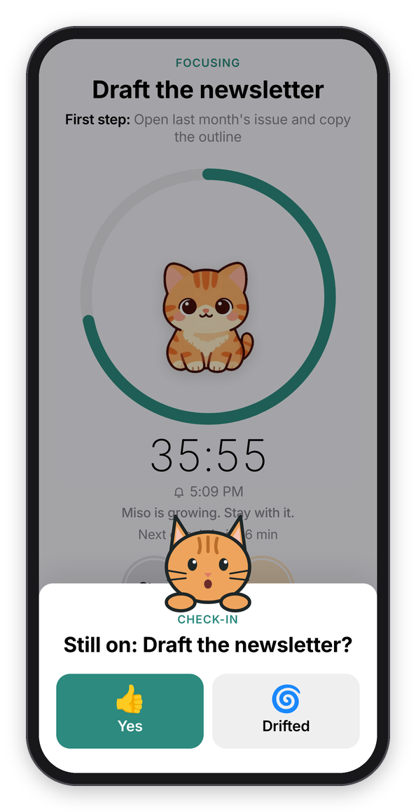
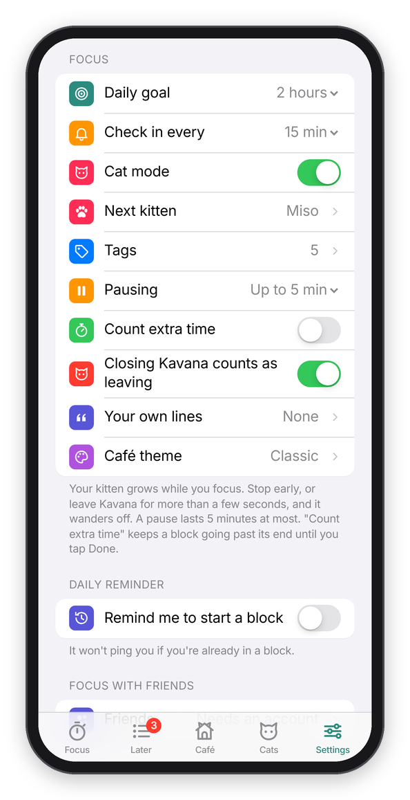

[Kavana docs](README.md) › Getting started

# What is Kavana?

Kavana is a focus timer that checks in on you while you work. The name is Hebrew (כוונה) for intention, the attention you bring to what you're doing. You type what you're working on, pick how long, and every so often it asks "Still on: ...?" If you drifted, you say so, and you're back on it a minute later instead of at the end of the hour.

*A check-in, with Cat mode on.*

## The idea: notice the drift, not just the time

Most focus timers count down and ring at the end. That tells you the time is up, but not that you left the work twenty minutes ago for your phone, which is the part I wanted help with. So Kavana checks in during the block, in one of two ways you pick for each block:

- **"Ask me"** asks "Still on: Draft the newsletter?" every 15 minutes, or however often you set it. You tap **Yes** or **Drifted**, and after Drifted it asks "What pulled you away?" (Phone, Messages, Email, The web, Thoughts, Someone, Tired, Hungry, Other).
- **"Nudge me"** doesn't ask anything. It sends a short line, like "One thing at a time." or a quote, at an uneven gap, so it doesn't feel like a metronome.

The check-ins come as notifications, so they reach you even when Kavana is closed, and at the end of the block it asks "How did it go?" and keeps a log. Basically, it's a timer with a friend sitting next to it who taps you on the shoulder now and then.

## What it does

- **A block**: what you're working on, an optional first step, and a timer (5, 25 or 50 minutes or your own number) or a stopwatch that counts up. You can cancel in the first 10 seconds, pause for up to 5 minutes, and keep counting past the end. See [A focus block](focus-blocks.md).
- **While it runs**: a ring that empties like the Clock app's timer with a kitten growing up inside it, pause, park a thought on your Later list, background sound (a purring cat among them), keep the screen on, and a disk timer.
- **Check-ins**: "Still on it?" as a card over the block, or a short line, and as notifications when the app is closed. See [Check-ins and Cat mode](check-ins.md).
- **Cats, like Forest**: the kitten you invite grows up while you focus and comes home to your Cat Café if you stay to the end. Stop early or leave Kavana and it wanders off. Sixteen cats, eight you meet by focusing and the rest you adopt with the 🐟 treats you earn, which also buy furniture, café themes and sounds, and sponsor shelter cats. Missions, a monthly challenge and 27 achievements pay extra. See [Cats](cats.md).
- **The Café**: the cats that came home by day, week, month or year, your focus time by tag and by hour, every block with its note, and your habits: a daily goal, a five-week heatmap, and a daily "Time to focus?" reminder. Share it as a picture. See [The Café, goal and the daily reminder](history.md).
- **Around it**: breaks with a "Break's over" ping, a mindful minute of breathing, and a What's new page.
- **Focus with friends**, with an account: see when a friend is focusing, nap together (with friends, or anyone with a room code), and weekly rankings with friends and worldwide if you want. See [Focus with friends](friends.md).

## Finding your way around

Kavana gets around the way Forest does. The Focus tab is the whole first screen: the café wall, the window with your cat in it, and one button. Everything else is in the menu, the button at the top left, which slides in from the side: **Focus**, **Café**, **Cats**, **Goals**, **Shop**, **Later**, **Rankings**, **Friends**, **A mindful minute**, **Shelter cats**, **What's new** and **Settings**, with today's minutes and your days in a row on top. Under that, the lists, sheets and alerts are still dressed like an app from Apple, on purpose, so it feels at home on an iPhone, an iPad or a Mac.

*An iPad in landscape, with the menu open.*

With a keyboard (an iPad with one, or a computer), **⌘1** to **⌘5** go to Focus, Later, Café, Cats and Settings, **⌘,** opens Settings, the space bar pauses and resumes a block, **N** jumps to "What are you working on?", and **Esc** closes the menu or a sheet, or goes back.

## Where your data lives

Kavana runs in your browser, and everything you do is kept there, in the browser's own storage. You don't need an account. If you turn on reminders, the server holds your device's next few pings so it can send them while the app is closed, and it deletes each one once it's sent. If you make an account, your data is also kept on the server, which backs it up and syncs it between your devices. [Accounts and privacy](privacy.md) has the details, including the usage counts and how to turn them off.

## What works where

| | iPhone or iPad, Home Screen app | iPhone or iPad, Safari tab | Android | A computer |
| --- | --- | --- | --- | --- |
| Blocks, check-ins in the app, Later, the Café | yes | yes | yes | yes |
| Reminders while the app is closed | yes (iOS and iPadOS 16.4 or newer) | no, Apple only allows them in the Home Screen app | yes, in Chrome or installed | yes, in browsers that do web notifications |
| Yes / Drifted on the notification itself | no, a tap opens Kavana and it asks there | | yes | depends on the browser |
| The cat's picture in the notification | no, the title gets a 🐱 | | yes | depends on the browser |
| Keep the screen on | if the device allows it | if the device allows it | if the device allows it | if the browser allows it |
| An account, sync, friends | yes | yes | yes | yes |
| Blocking sites during a block | no | no | no | with [the browser extension](extension.md), in Chrome, Edge, Brave or Firefox |

One thing to know about iPhones and iPads: the Home Screen app keeps its own data, separate from Safari. If you used Kavana in Safari first, sign in to your account in the Home Screen app and everything comes along. Without an account, the two start separately.

## Settings, in one place

**Settings** is the last tab, and it's laid out like the Settings app:

- **Your account**, at the top: **Sign In** (or **Create Account**), and once you're signed in, your name, **Sign Out** and **Delete My Account**.
- **Focus**: **Daily goal**, **Check in every** (10 to 60 minutes, or **Only at the end**), **Cat mode**, **Next kitten**, which takes you to the Cats tab, **Tags**, **Pausing** (up to 5 minutes, or off), **Count extra time**, **Closing Kavana counts as leaving**, **Block sites while you focus** (on a computer, which says **On** once [the browser extension](extension.md) is installed and opens its guide), **Your own lines** (for "Nudge me") and **Café theme**.
- **Daily reminder**: **Remind me to start a block**, at a time and on the days you pick.
- **Focus with friends**: **Friends** opens what you share, the name they see, your friend code, and your friends.
- **Notifications**: whether reminders are on for this device, **Turn On** or **Test**, and **Chime when Kavana is open**.
- **Privacy**: what's kept where, and **Share anonymous usage counts**.

*Settings.*

## What it isn't

Kavana doesn't block apps or websites the way Forest's Deep Focus does. A web app can't, and honestly that's not what it's for: it's there to help you notice, not to lock the door (the kitten wandering off is about as strict as it gets). It's a small project I made and run myself, it's free, and there's nothing to buy with real money.

## Next step

If you want to try it, [Install](install.md) gets it onto your phone, iPad or computer, with the reminders on.

Next: [Why I made it](why-i-made-it.md) →
