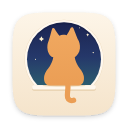

<h1 align="center">Kavana for Chrome and Firefox</h1>

While a Kavana focus block runs, the sites on your list show a cat instead.

This is Kavana's browser extension, the cat version of Forest's. Start a block in Kavana, and YouTube, Reddit, X and the rest of your list show "Boo! Miso is growing." with what you're working on, how long is left, and a button back to Kavana. When the block's over, the list switches itself off and the page you wanted opens by itself.

It doesn't need an account and it doesn't talk to any server. It hears about your blocks from the Kavana page itself, so there's nothing to set up: install it, and the next block you start turns the list on.

## Install it

It isn't in the Chrome Web Store or on Firefox Add-ons yet, so for now you load this folder yourself:

- **Chrome, Edge or Brave:** open `chrome://extensions`, turn on **Developer mode**, click **Load unpacked** and pick this `extension` folder.
- **Firefox 140 or newer, or Zen:** open `about:debugging#/runtime/this-firefox`, click **Load Temporary Add-on…** and pick `manifest.json` in this folder. Firefox forgets a temporary add-on when it quits, so you'll load it again after a restart until it's signed.

The whole guide, with the list, the toolbar button, how it fits with the kitten and what it can see, is in [The browser extension](../docs/extension.md).

## What's in here

- `manifest.json`: Manifest V3, the same file for Chromium and Firefox.
- `kavana.js` runs on the Kavana page and keeps the latest `kavana-block` event in the extension's storage.
- `background.js` turns the `declarativeNetRequest` redirect rule on and off, sets the alarm for the end of the block, and keeps the minutes left on the toolbar button. `common.js` is shared by it and the pages.
- `blocked.html` is the cat page, `options.html` the list ("Sites to block") and `popup.html` the toolbar button, with `style.css` in Kavana's colors.
- `icons/` are drawn by `tools/make-icons.py`, and `icons/kitten.webp` is Miso's kitten painting from `web/cats/`, for when the cat page can't reach Kavana.

To check it in a real browser, run `node tools/ext-check.js http://localhost:<port>/ <out dir>` (headless Chromium) or `node tools/ext-check-firefox.js` (headless Firefox) against a sandbox Kavana, never the live site.
